## Monday 2 November (Day 1) {.smaller}

**G53/G54**

| Time | Session | Presenter |
|:---|:---|:---|
| 09:00–10:00 | ☕ Registration & coffee | — |
| 10:00–10:15 | Diamond welcome | Julia Parker |
| 10:15–10:20 | Workshop introduction and Day 1 agenda | Daniil Kazantsev |
| 10:20–10:50 | Tomography basics: Part 1: Introduction to Tomography | Alexender Liptak |
| 10:50–11:05 | ☕ Coffee 15-min break | — |
| 11:05–11:30 | Introduction to HTTomo | Daniil Kazantsev |
| 11:30–12:00 | Tomography basics: Part 2: Running a tomography experiment using HTTomo | Alexender Liptak |
| 12:00–13:00 | 🥪 Lunch  — Atrium | — |
| 13:00–15:00 | Tutorial I: getting started | Daniil Kazantsev / Yousef Moazzam |
| 15:00–15:30 | ☕ Coffee 30-min break | — |
| 15:30–17:00 | Tutorial II: running end-to-end pipelines on Diamond HPC | Daniil Kazantsev / Yousef Moazzam |
| 17:00–17:30 | Break | — |
| 17:30–18:30 | 🖼️ Posters — Atrium | — |
| 18:30 onwards | 🍽️ Dinner — Atrium | — |

::: {.footer}
[Published agenda](https://www.diamond.ac.uk/Home/Events/2026/Tomography-Workshop-HTTomo.html)
:::


## Tuesday 3 November (Day 2) {.smaller}

**G53/G54**

| Time | Session | Presenter |
|:---|:---|:---|
| 09:00–09:05 | Day 2 introduction | Daniil Kazantsev |
| 09:05–09:45 | Tomography beamlines | Beamline staff |
| 09:45–10:30 | Beamline tours | — |
| 10:30–11:00 | ☕ Coffee 30-min break | — |
| 11:00–11:30 | HTTomo web interfaces | Yousef Moazzam |
| 11:30–12:00 | Output visualisation tools | Benedikt Daurer |
| 12:00–12:15 | 📸 Group photo | — |
| 12:15–13:00 | 🥪 Lunch — Atrium | — |
| 13:00–14:30 | Tutorial III: web interface & output visualisation | Daniil Kazantsev / Yousef Moazzam |
| 14:30–15:00 | ☕ Coffee 30-min break | — |
| 15:00–16:30 | Tutorial IV: Q&A, debugging, intermediates & installation | Daniil Kazantsev / Yousef Moazzam |
::: {.footer}
[Published agenda](https://www.diamond.ac.uk/Home/Events/2026/Tomography-Workshop-HTTomo.html)
:::


## Workshop objectives

By the end of the workshop, you will be able to:

- **Explain the tomography workflow:** data acquisition, reconstruction and analysis.
- **Describe HTTomo’s role** in processing large tomography datasets.
- **Build and run custom YAML pipelines** using HTTomo’s processing methods.
- **Submit and monitor jobs on Diamond’s cluster**, and troubleshoot common problems.
- **Apply complete processing workflows to real datasets** and assess reconstruction quality.
- **Use Diamond’s new web interface** to submit HTTomo jobs from a browser.


<!--
####################################################
####################################################
##############Introduction to HTTomo################
####################################################
####################################################
-->

## Introduction to HTTomo

:::: {.columns}
::: {.column width="46%"}

- What is HTTomo?
- Input and output
- Pipelines, YAML and templates
- Processing libraries as backends
- Input data format: HDF5/NeXus
- Loader and previewing
- How to run HTTomo at Diamond

:::
::: {.column width="50%"}

{.nostretch width=100% fig-alt="HTTomo workflow from projections to reconstruction using GPUs and cluster resources."}
:::
::::

##

{width=100% height=700px style="object-fit: contain;" fig-alt="Tomographic imaging at Diamond Light Source."}

::: {.footer}
[Diamond Light Source website](https://www.diamond.ac.uk/Home.html)
:::

## What is HTTomo?

**HTTomo is open-source software for parallel-beam tomography data processing and reconstruction.**

It is designed for high-throughput processing, i.e., handling large amounts of scan data with computational efficiency.

::: {style="text-align: center; margin: 1.2em 0; padding: 0.7em 0; border-top: 2px solid #66c2d7; border-bottom: 2px solid #66c2d7; font-size: 1.2em;"}
**Load scan data → Correct the images → Reconstruct → Save results**
:::

:::: {.columns}
::: {.column width="48%"}

::: {.fragment}

### You provide

- **Scan data:** X-ray images taken at different angles saved into a data file. 
- **A processing recipe:** a [YAML](#what-is-yaml) text file listing the steps or methods and their parameters.

:::

:::
::: {.column width="48%"}
::: {.fragment}

### HTTomo handles

- Running the processing steps in descending order.
- Managing data and memory, with support for GPU processing and HPC clusters.

:::
:::
::::


## What else is HTTomo?

:::: {.columns}

::: {.column width="27%"}
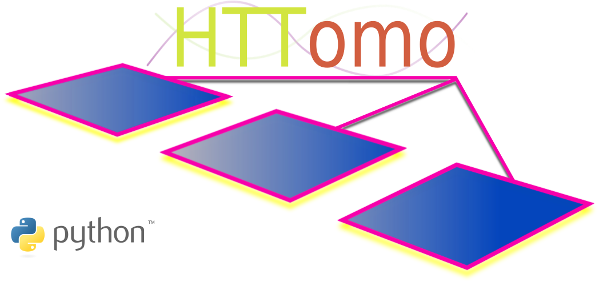{width=90% fig-alt="HTTomo logo"}
:::

::: {.column width="68%"}

- A software written in modern **Python** language, using object-oriented design.
- A framework for **parallel data processing**.
- Designed to **scale to increasingly large datasets**.
- Supports **plug-and-play processing methods** from TomoPy and in-house GPU-accelerated libraries.
- Separates processing from an **independent, replaceable user interface**.
:::
::::

::: {.footer}
[HTTomo github page](https://github.com/DiamondLightSource/httomo)
:::


## Input and Output in HTTomo {#input-output}

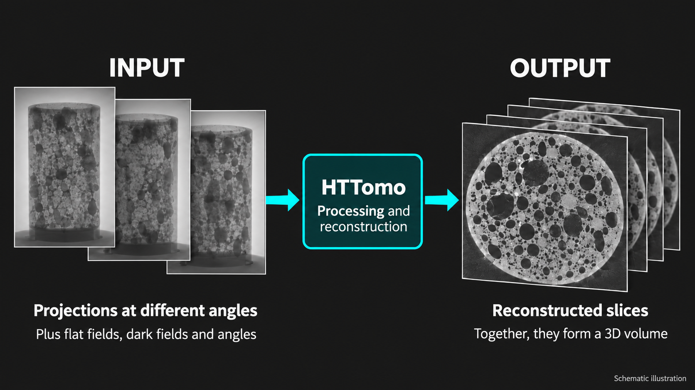{width=80%}

## What is a pipeline?

A **pipeline** is a sequence of steps that processes your data.

1. **Load** the projection data.
2. **Calibrate** data using flat and dark fields (if available).
3. **Pre-process** data with various filters
4. **Reconstruct** slices that reveal the sample’s inner structure.
5. **Save** the results for inspection.

Each step passes its result to the next step.

::: {.fragment}
In **HTTomo**, a [YAML](#what-is-yaml) file orchestrates how the steps should run.
:::

## What is YAML? {#what-is-yaml}

**YAML** stands for **YAML Ain’t Markup Language**. It is a readable text format for storing configuration.

In HTTomo, YAML describes **which methods to run, in what order, and with which parameters**.


::: {.fragment}

- **Dashes (`-`)** introduce list items.
- **Key–value pairs** define settings or parameters: `kernel_size: 3`
- **Indentation** groups related settings. Use spaces, not tabs.
- **Comments (`#`)** explain settings.

```yaml
# A method in an HTTomo pipeline
- method: remove_outlier
  module_path: httomolibgpu.misc.corr
  parameters:
    kernel_size: 3
    dif: 1000
```

:::


## Reading/editing YAML {#editing_yaml}

Use an editor such as [VS Code in your browser](https://vscode.dev/). Enable **Render Whitespace** to spot tabs and indentation.

| Common mistake | Incorrect example | Correct example |
|---|---|---|
| **Tabs for indentation** | <code>parameters:<br>[TAB]kernel_size: 3</code> | <code>parameters:<br>&nbsp;&nbsp;kernel_size: 3</code> |
| **Misaligned parameters** | <code>parameters:<br>&nbsp;&nbsp;kernel_size: 3<br>dif: 1000</code> | <code>parameters:<br>&nbsp;&nbsp;kernel_size: 3<br>&nbsp;&nbsp;dif: 1000</code> |
| **Missing space after `:`** | `kernel_size:3` | `kernel_size: 3` |
| **Missing list-item dash** | `method: remove_outlier` | `- method: remove_outlier` |
| **Misspelled names** | <code>method: remove_outliers<br>kernal_size: 3</code> | <code>method: remove_outlier<br>kernel_size: 3</code> |

`[TAB]` represents a tab character. The corrected examples use **two spaces per indentation level**; method parameters sit beneath `parameters:`.


::: {.fragment}

::: {.callout-warning style="font-size: 1.2em;"}

HTTomo does perform some checks of the YAML file, however, **valid YAML is not always a valid HTTomo pipeline:** a spelling error or incorrect nesting can parse successfully, but fail HTTomo’s checks.

:::
:::


## How do we tell HTTomo what to do?

We give HTTomo a **pipeline file written in YAML**.

This file describes:

- **Which methods** to use.
- **What order** to run them in.
- **Which settings** each method needs.

::: {.fragment}
Then at Diamond we run HTTomo by submitting a job to the computer cluster called `wilson`. For this, you require an input dataset, a pipeline file and an output folder:

```bash
httomo_mpi input.nxs pipeline.yaml output_dir
```
:::

::: {.footer}
[How to run HTTomo at Diamond](#how_to_run_httomo)
:::

## Where do the methods come from?

HTTomo runs processing methods provided by [Python processing libraries](https://diamondlightsource.github.io/httomo/backends/list.html#backends-list) also called [backends](https://diamondlightsource.github.io/httomo/reference/glossary.html#term-backend).

| Library | What it provides |
|---|---|
| [TomoPy](https://tomopy.readthedocs.io/en/stable/) | A well-known library of methods for tomography processing and reconstruction on CPUs. |
| [HTTomolibGPU](https://diamondlightsource.github.io/httomolibgpu/)  | Our in-house developed library of GPU processing and reconstruction methods. |
| [HTTomolib](https://diamondlightsource.github.io/httomolib/) | Our in-house library of CPU processing methods and utilities. |


::: {.fragment}

In HTTomo, **`module_path`** provides information in which module to find a  **`method`**. HTTomo **imports** that method just before the execution of the method, i.e., during the HTTomo's runtime. 

```yaml
- method: remove_outlier
  module_path: httomolibgpu.misc.corr
```
:::

::: {.footer}
[TomoPy](https://github.com/tomopy/tomopy) ·
[HTTomolibGPU](https://github.com/DiamondLightSource/httomolibgpu)
[HTTomolib](https://github.com/DiamondLightSource/httomolib) ·
:::

## Consider one HTTomo processing step

This step removes outliers, such as isolated bright pixels, from the data.

```{.yaml code-line-numbers="1|2|3-5"}
- method: remove_outlier
  module_path: httomolibgpu.misc.corr
  parameters:
    kernel_size: 3
    dif: 1000
```

**`method`** — which operation to perform.

**`module_path`** — where HTTomo finds the method.

**`parameters`** — settings that control the method.

## How to find a processing method?

A **method template** is a YAML snippet you can copy into your pipeline.

1. Open [Methods YAML Templates](https://diamondlightsource.github.io/httomo/backends/templates.html).
2. Choose templates for your version: **Archived** for a tagged release, or **Latest** for the development version (we will use **latest** templates for this workshop).
3. Browse the library and module, or use the documentation search to find a method.
4. Copy its **YAML template** into your pipeline.
5. Follow the module’s **API documentation** link to learn what the method does and what its parameters mean.

**Demo example:** Find `remove_outlier` in `httomolibgpu.misc.corr`.

## A general structure of complete pipeline

A pipeline combines individual methods into **one ordered YAML list**.

For example, a full pipeline can contain the following methods:

<table class="pipeline-table">
<thead>
<tr><th>Group</th><th>Step no.</th><th>Method</th><th>Purpose</th></tr>
</thead>
<tbody>
<tr class="loader">
  <td class="group">Loader</td>
  <td>1</td>
  <td><code>standard_tomo</code></td>
  <td>Load projections, calibration images and angles.</td>
</tr>
<tr class="preprocessing">
  <td class="group" rowspan="4">Pre-processing</td>
  <td>2</td>
  <td><code>remove_outlier</code></td>
  <td>Remove isolated outliers.</td>
</tr>
<tr class="preprocessing">
  <td>3</td>
  <td><code>dark_flat_field_correction</code></td>
  <td>Correct projections using flat and dark fields.</td>
</tr>
<tr class="preprocessing">
  <td>4</td>
  <td><code>remove_all_stripe</code></td>
  <td>Reduce stripes that can produce ring artefacts.</td>
</tr>
<tr class="preprocessing">
  <td>5</td>
  <td><code>minus_log</code></td>
  <td>Convert transmission into attenuation values.</td>
</tr>
<tr class="reconstruction">
  <td class="group">Reconstruction</td>
  <td>6</td>
  <td><code>FBP3d_tomobar</code></td>
  <td>Reconstruct slices from the processed projections.</td>
</tr>
<tr class="saving">
  <td class="group">Saving</td>
  <td>7</td>
  <td><code>save_to_images</code></td>
  <td>Save the reconstruction as images to the disk.</td>
</tr>
</tbody>
</table>

## HDF5 and NeXus data formats

**HDF5** (`.h5`, `.hdf5`) stores large arrays and metadata in one file.

- **Groups** organise the contents like folders.
- **Datasets** hold values, such as images or rotation angles.
- **Attributes** describe the data, such as its units.

**NeXus** (often `.nxs`) builds on HDF5 with standard names and
structures for experimental data. **NeXus**  uses HDF5 with conventions for organising scientific data. **NeXus** file can contain data or just metadata and links to **HDF5** datasets.

::: {.fragment}
### How HTTomo uses them

The **`standard_tomo`** [loader](#loader) reads the projections, flat and dark
fields, and rotation angles.

Loader configuration tells HTTomo **where these datasets are inside
the file**.
:::
::: {.footer}
[HDF5 introduction](https://portal.hdfgroup.org/documentation/hdf5/latest/_intro_h_d_f5.html) ·
[NeXus introduction](https://manual.nexusformat.org/introduction.html)
:::

## Visualising HDF5 and NeXus files

Browse the file hierarchy, inspect metadata, then plot a dataset.

:::: {.columns}
::: {.column width="48%"}
### [DAWN](https://dawnsci.org/) (Diamond's tool of choice)

**Desktop visualisation and analysis**

- Browse HDF5 and NeXus data.
- Fast data visualisation in 1D, 2D and 3D.
- Use scientific processing workflows.
:::

::: {.column width="48%"}
### [myHDF5](https://myhdf5.hdfgroup.org/) (Web-based)

**Quick exploration in your browser**

- Open local HDF5 files without installation.
- Explore groups and datasets, and visualise arrays.
- Local files stay on your computer.
:::
::::

### Other useful choices

::: {.smaller}
- [HDFView](https://www.hdfgroup.org/download-hdfview/): inspect and edit HDF5 structure, attributes and data.
- [silx view](https://www.silx.org/doc/silx/latest/applications/view.html): browse HDF5 and plot NeXus `NXdata` groups.
- [NeXpy](https://nexpy.github.io/nexpy/): explore and analyse NeXus data with a Python GUI.
:::


## Using Dawn to visualise the data

A sinogram view in [DAWN](https://dawnsci.org/) of a synthetic dataset packed into a NeXus file `tomodata_synth.nxs`.

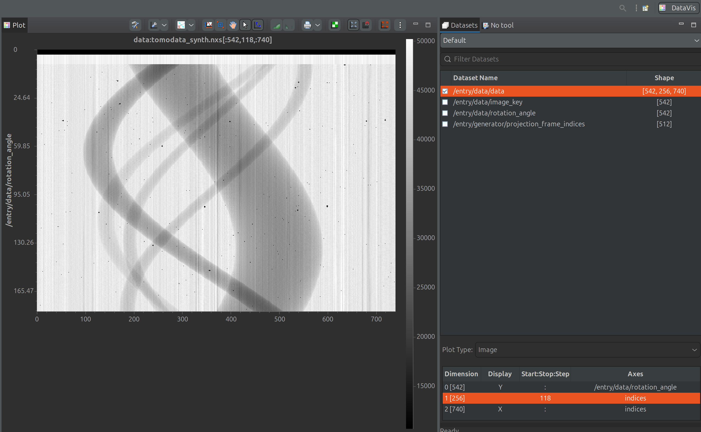{
  .nostretch
  width=70%
  fig-alt="Synthetic tomography data in DAWN"
}


## Data loading and previewing in HTTomo

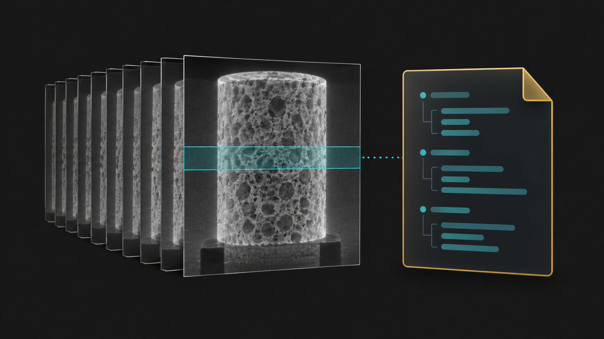{
  .nostretch
  width=70%
  fig-alt="Data previewing in HTTomo"
}


## HDF5/NeXus loader and data previewing {#loader .smaller}

::: {.columns}
::: {.column width="54%"}
###  YAML for the HDF5/nxs loader

```yaml
- method: standard_tomo
  module_path: httomo.data.hdf.loaders
  parameters:
    data_path: auto # 'auto' key for NXtomo standard
    image_key_path: auto
    rotation_angles: auto
    preview:
      detector_x: # horizontal previewing
        start: null # keep full range
        stop: null  # keep full range
      detector_y: # vertical previewing
        start: null # keep full range
        stop: null  # keep full range
    darks: null   # darks defined by keys
    flats: null   # flats defined by keys
```
:::

::: {.column width="2%"}
<!-- empty column to create gap -->
:::

::: {.column width="42%"}

::: {.fragment}

### Previewing

[Data previewing](https://diamondlightsource.github.io/httomo/howto/loading_data/previewing.html) **crops the data during loading**.

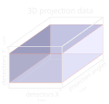{width=50% fig-alt="HTTomo projection data axes, showing cropping along detector Y."}

**Array axis order:**

0. `angles` — projection index
1. `detector_y` — vertical detector position
2. `detector_x` — horizontal detector position

:::
:::
:::

::: {.footer}
[HTTomo standard loader](https://diamondlightsource.github.io/httomo/howto/loading_data/standard_loader.html)
:::


## Previewing examples {#previewing-examples .smaller}

::: {.columns}
::: {.column width="50%"}

Example 1 (vertical preview):

```yaml
  preview:
    detector_y:
      start: 50
      stop: 100
```

::: {.fragment}
Example 2 (vertical preview with `mid` keyword):

```yaml
  preview:
    detector_y:
      start: mid
      start_offset : -10
      stop: mid
      stop_offset : 10
```
:::

:::
::: {.column width="50%"}

::: {.fragment}
Example 3 (vertical and horizontal preview using `begin`, `end` and `mid` keywords):

```yaml
preview:
  detector_x:
    start: begin
    start_offset: 100
    stop: end
    stop_offset: -100
  detector_y:
    start: mid
    start_offset: -50
    stop: mid
    stop_offset: 50
```
::: {.callout-warning style="font-size: 1.4em;"}
Crop `detector_x` only when the sample is fully within the field of view. Otherwise you can remove part of the useful data and it will lead to incorrect reconstructions.
:::
:::
:::
:::
::: {.footer}
[Previewing](https://diamondlightsource.github.io/httomo/howto/loading_data/previewing.html)
:::


## Example of a full pipeline

<div style="height: 560px; overflow-y: auto; font-size: 0.85em;">

```yaml
# --- Standard tomography loader for NeXus files. ---
- method: standard_tomo
  module_path: httomo.data.hdf.loaders
  parameters:
    data_path: auto
    image_key_path: auto
    rotation_angles: auto
    preview:
      detector_x:   # horizontal data previewing/cropping.        
        start: null # null -  no previewing
        stop: null
      detector_y:
        start: mid
        start_offset : -10
        stop: mid
        stop_offset : 10    
    darks: null
    flats: null
# --- Removing unresponsive/dead pixels in the data, aka zingers. Use if sharp streaks are present in the reconstruction. To be applied before normalisation. ---
- method: remove_outlier
  module_path: httomolibgpu.misc.corr
  parameters:
    kernel_size: 3  # The size of the 3D neighbourhood surrounding the voxel. Odd integer.
    dif: 1000 # A difference between the outlier value and the median value of neighbouring pixels.
# --- Normalisation of projection data using collected flats/darks images. --- 
- method: dark_flat_field_correction
  module_path: httomolibgpu.prep.normalize
  parameters:
    flats_multiplier: 1.0
    darks_multiplier: 1.0
    upper_bound: null
    lower_bound: null
- method: minus_log
  module_path: httomolibgpu.prep.normalize
  parameters: {}
# --- stripe removal method. ---  
- method: remove_stripe_fw
  module_path: httomolibgpu.prep.stripe
  parameters:
    sigma: 2
    wname: db5
    level: null  
# --- Reconstruction method. ---
- method: LPRec3d_tomobar
  module_path: httomolibgpu.recon.algorithm
  parameters:
    center: null
    detector_pad: false
    filter_type: shepp
    filter_freq_cutoff: 1.0
    recon_size: null
    recon_mask_radius: 0.95 
# --- Calculate global statistics on the reconstructed volume, required for data rescaling. ---
- method: calculate_stats
  module_path: httomo.methods
  parameters: {}
  id: statistics
  side_outputs:
    glob_stats: glob_stats
# --- Rescaling the data using min/max obtained from `calculate_stats`. ---
- method: rescale_to_int
  module_path: httomolib.misc.rescale
  parameters:
    perc_range_min: 1.0
    perc_range_max: 99.0
    bits: 16
    glob_stats: ${{statistics.side_outputs.glob_stats}}
# --- Saving data into images. ---
- method: save_to_images
  module_path: httomolib.misc.images
  parameters:
    subfolder_name: images
    axis: auto
    file_format: tif  # `tif` or `jpeg` can be used.
    asynchronous: true    
```
</div>


## How to run HTTomo at Diamond {#how_to_run_httomo .smaller}

1. Connect to **Wilson** using your `fedid`, then load the **latest** HTTomo version:

```bash
ssh wilson
module load httomo/latest
```

::: {.fragment}
2. Define the workshop folder **once in your Wilson terminal**:

```bash
export HTTOMO_WORKSHOP=/dls/k11/data/2026/mg47440-2/processing/httomo-workshop
```

Use `${HTTOMO_WORKSHOP}` in paths below. Repeat the export in each new terminal session.
:::

::: {.fragment}
3. Submit your pipeline, using paths relative to the workshop folder:

```bash
httomo_mpi "${HTTOMO_WORKSHOP}/data/input.nxs" \
  "${HTTOMO_WORKSHOP}/pipelines/pipeline.yaml" \
  "${HTTOMO_WORKSHOP}/output/${USER}/exercise_output"
```

Replace `data/input.nxs` and `pipelines/pipeline.yaml` with your dataset and pipeline paths. `${USER}` is your login name and gives you a personal output location.
:::

::: {.fragment}
4. Check your job with `squeue -u "$USER"`. 
:::

::: {.footer}
[Running HTTomo at Diamond](https://diamondlightsource.github.io/httomo/getting_started/at_diamond.html)
:::


## What happens when a job gets submitted to the cluster?

You submit **one pipeline** for **one dataset** at the time. HTTomo submitter and cluster scheduler organise the work.

:::: {.columns}

::: {.column width="57%"}

::: {.fragment fragment-index="0"}
**1. Validate the YAML pipeline**  
HTTomo checks the provided YAML pipeline file. Correct any reported errors before proceeding.
:::

::: {.fragment fragment-index="1"}
**2. Wait for compute resources**  
**SLURM**, the cluster’s scheduler, queues the job and allocates a compute node (or multiple nodes) with GPUs when resources become available.
:::

::: {.fragment fragment-index="2"}
**3. Share the work across GPUs**  
HTTomo divides the data into chunks. **MPI** coordinates workers that process different chunks at the same time.
:::

::: {.fragment fragment-index="3"}
**4. Write the results**  
HTTomo saves the output and logs in your run folder.
:::

:::

::: {.column width="43%"}

::: {.fragment fragment-index="1"}

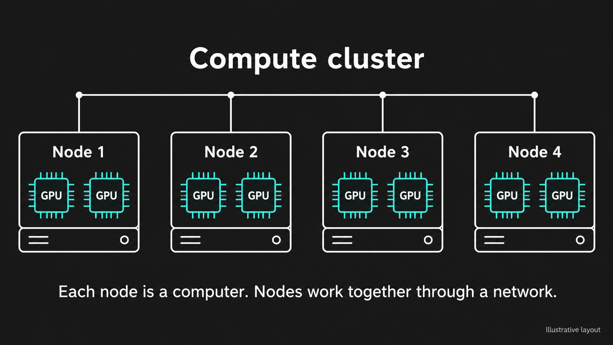{width=100% fig-alt="Compute nodes connected by a network, each containing GPUs."}

A **node** is one computer in the cluster.

Your job uses the resources allocated to it.

:::
:::
::::

## Tutorial Part I: Running HTTomo

- First reconstruction using a supplied pipeline and synthetic data
- Configuring the loader and selecting a detector preview
- Pre-processing: dark/flat correction, negative log, outlier and stripe removal
- Reconstruction: centre of rotation, padding, masking and filters
- Rescaling and saving reconstructed images
- Reading HTTomo logs and sweeping the centre of rotation

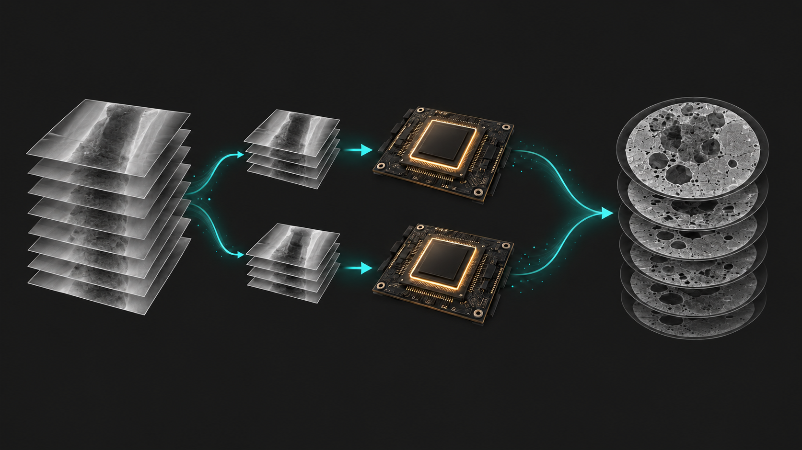{.nostretch width=45%}

## Exercise 1: a quick run test reconstruction {#exercise1}

### Initiate your first HTTomo run

Following [How to run HTTomo at Diamond](#how_to_run_httomo):

```bash
ssh wilson
module load httomo/latest
export HTTOMO_WORKSHOP=/dls/k11/data/2026/mg47440-2/processing/httomo-workshop
```

1. Use the small synthetic dataset `tomodata_synth.nxs`, you can inspect it in Dawn first. The data folder is:
```bash
"${HTTOMO_WORKSHOP}/data/"
```
2. Use the `exercise1.yaml` pipeline in: 
```bash
"${HTTOMO_WORKSHOP}/pipelines/"
```
3. Create your output directory with
```bash
mkdir "${HTTOMO_WORKSHOP}/output/${USER}"
```

## Exercise 1: a quick run test reconstruction {#exercise1_part2}

4. Run HTTomo with all paths provided:
```bash
httomo_mpi "${HTTOMO_WORKSHOP}/data/tomodata_synth.nxs" \
 "${HTTOMO_WORKSHOP}/pipelines/exercise1.yaml" \
 "${HTTOMO_WORKSHOP}/output/${USER}/exercise1_output" --resource small
```

5. **Next:** check the run folder and inspect your reconstruction.

::: {.callout-note style="font-size: 1.2em;"}

Check that the user folder is created in step 3 of [Exercise 1](#exercise1) directions.

:::

## First reconstruction: output files

Open the new **timestamped run folder** inside `exercise1_output`.

| Find | What to do |
|---|---|
| `user.log` | Read the progress messages and check how the run ended. |
| `exercise1.yaml` | The YAML pipeline used for this run. |
| Reconstruction saved as HDF5 file | Open the reconstructed dataset in an HDF5 viewer (DAWN). |
| `debug.log` | More verbose logging to help diagnosing a problem. |
| `httomo.o` | Slurm log file that follows `user.log`, and provide information about the job execution. |
| `images16bit_tif` | TIFF images of the reconstructed volume, check with ImageJ |


## Exercise 2: previewing the data

### Learn how to preview the data.

Following [previewing examples](#previewing-examples), modify the loader's `preview` settings to select:

1. Select a **20-row** chunk in the middle of the detector. Edit `detector_y` preview and use `mid` keyword with offsets.
2. Select a `detector_x` region that starts 15 pixels from the beginning and ends 15 pixels before the end of the detector. Use `begin` and `end` keywords with offsets.
3. Re-run the pipeline and inspect the results. Check that the output reconstruction is smaller than before.

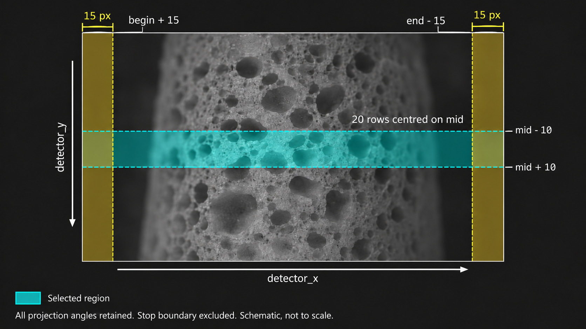{.nostretch width=46%}


## Exercise 3: configure the loader {#exercise3 .smaller}

### Read data without the NXTomo layout

:::: {.columns}
::: {.column width="47%"}

1. Open **`lorentz_data.h5`** ([TomoBank Lorentz dataset](https://tomobank.readthedocs.io/en/latest/source/data/docs.data.lorentz.html)) from the workshop `data` folder in **DAWN**.
2. Find the dataset paths for **projections**, **darks** and **flats** (called **white** in this case).
3. Fill in the three **`data_path`** entries in the template.
4. Add dark/flat correction after the loader and save the pipeline into `exercise3.yaml`.
```{.yaml code-line-numbers="false"}
- method: dark_flat_field_correction
  module_path: httomolibgpu.prep.normalize
  parameters:
    flats_multiplier: 1.0
    darks_multiplier: 1.0
    upper_bound: null
    lower_bound: null
    clipping_warning: false
  save_result: true
```
5. [Run HTTomo](#how_to_run_httomo) with `lorentz_data.h5` and `exercise3.yaml`.
6. Inspect the saved normalised data in **DAWN** (sinogram slicing). 
:::

::: {.column width="47%"}
```{.yaml code-line-numbers="false"}
- method: standard_tomo
  module_path: httomo.data.hdf.loaders
  parameters:
    data_path: # projection dataset path
    image_key_path: null # as there are no keys
    rotation_angles: # in degrees
      user_defined:
        start_angle: 0
        stop_angle: 179.876
        angles_total: 1500
    preview:
      detector_y:
        start: mid
        start_offset: -25
        stop: mid
        stop_offset: 25
    darks:
      file: input_data
      image_key_path: null
      data_path: # dark dataset path
    flats:
      file: input_data
      image_key_path: null
      data_path: # flat dataset path
    continuous_scan_subset: null
```
:::
::::

::: {.footer}
[HTTomo real-data examples](https://diamondlightsource.github.io/httomo/howto/tutorial/real_data_example.html)
:::

## Data pre-processing

- Dark/flat correction
- Outliers removal (dezingering)
- Stripes/ring removal 

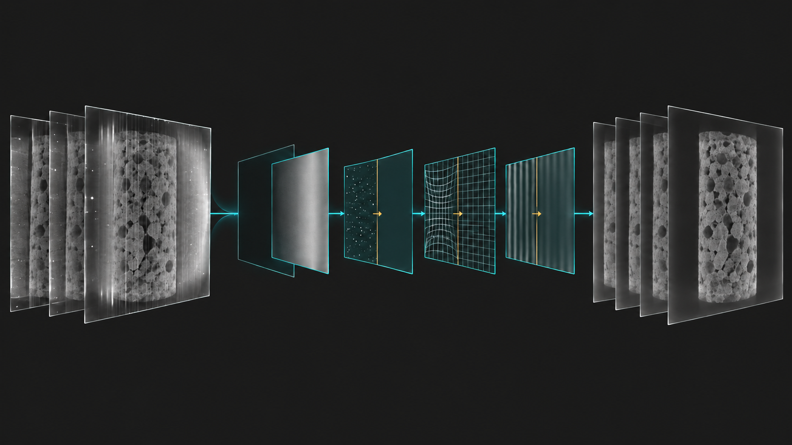{.nostretch width=70%}

## Transmission data calibration and linearisation {#calibration-linearisation .smaller}

:::: {.columns}
::: {.column width="43%"}

**1. Dark/flat correction: estimate transmission**

$$T = \frac{I-D}{F-D}$$

$I$: sample image  
$D$: mean dark image, beam off  
$F$: mean flat image, beam on without the sample

Subtracting $D$ removes detector offset. Dividing by $F-D$ corrects illumination and pixel-response variations.

::: {.fragment fragment-index="0"}

**2. Negative log: obtain an attenuation projection**

$$p=-\ln T \approx \int_{\mathrm{ray}}\mu(s)\,ds$$

The Beer–Lambert model converts transmission into the **line integrals used in reconstruction**.

:::
:::
::: {.column width="57%"}

::: {.fragment fragment-index="0"}

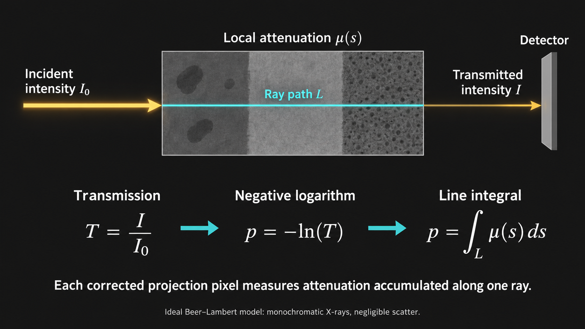{.nostretch width=100% fig-alt="X-ray attenuation through a sample and conversion of transmission into a line integral using the negative logarithm."}

In the figure, $I$ and $I_0$ represent ideal intensities. For measured data, use the corrected ratio $(I-D)/(F-D)$.

:::
:::
::::

## Exercise 4: Dark/flat field correction {#exercise4}

### Data callibration and linearisation

1. Use already created pipeline `exercise3.yaml` from [Exercise 3](#exercise3)
2. Open the page with the [templates](https://diamondlightsource.github.io/httomo/backends/templates.html), find `minus_log` method of `httomolibgpu.prep.normalize` module.
3. Copy paste the `minus_log` template to the end of your pipeline.
4. Enable [saving a method result](https://diamondlightsource.github.io/httomo/howto/httomo_features/save_results.html) for **minus_log** and disable for `dark_flat_field_correction`.
5. Run HTTomo with **`lorentz_data.h5`** data.
6. Inspect the results in **DAWN**.

## Outliers: small pixel errors

:::: {.columns}
::: {.column width="48%"}

**What are outliers?**

Unusually bright or dark pixels that differ sharply from their neighbours,
 often called **zingers**. They can produce streaks in a reconstruction.


::: {.fragment}

**How does a dezinger work?**

Compare each value with the **local median**. Replace it only when the
 difference exceeds a threshold.

Parameters of `remove_outlier` method in `httomolibgpu.misc.corr`:

- `kernel_size`: the size of the neighbourhood.
- `dif`: the threshold for replacement. A larger value makes the filter more selective.
:::
:::
::: {.column width="2%"}
:::
::: {.column width="50%"}

**Projection with outliers**

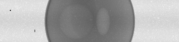{.nostretch width=100% fig-alt="Projection containing isolated bright and dark outlier pixels."}

**After outlier removal**

{.nostretch width=100% fig-alt="The projection after selective median-based outlier removal."}

**Check the difference:** remove the outliers while preserving real sample detail.

:::
::::

::: {.footer}
[HTTomolibGPU: outlier removal and example images](https://diamondlightsource.github.io/httomolibgpu/reference/methods_list/correction/outlier_removal.html)
:::

## Exercise 5: pre-processing (de-zingering) {#exercise5}

1. Use synthethic dataset `tomodata_synth.nxs` to remove **outliers** from the projections, flats, and darks.

2. Add HTTomolibGPU's [remove_outlier](https://diamondlightsource.github.io/httomo-backends/api/httomolibgpu.misc.corr.html) template to your pipeline after the loader.

3. Add save result for the **`remove_outlier`** method.

4. Tweak **`dif`** parameter to see the effect of dezinging. Do not make it too small, if **`dif: 0`**, the method is equivalent to a median filter (each pixel will be filtered).

## Removing stripes and ring artefacts {.smaller}

:::: {.columns}
::: {.column width="48%"}

### Why do rings appear?

Persistent errors at detector positions create **stripes in sinograms**.
Reconstruction can turn these stripes into **rings around the rotation axis**.

A **sinogram** shows one detector row across all projection angles.

::: {.fragment}

### Basic approaches to stripe removal

- **Equalise responses:** estimate and correct intensity differences between neighbouring detector positions, for example using sorting and median filtering.
- **Filter stripe patterns:** suppress stripe-related components using Fourier or wavelet filters.
- **Detect and replace:** identify unreliable detector columns and interpolate from neighbouring data.

Methods can be combined when several stripe types occur together.

:::
:::
::: {.column width="2%"}
:::
::: {.column width="50%"}

**Sinogram: before and after correction**

<div style="display: flex; gap: 18px; align-items: flex-start;">
<div style="width: 50%; text-align: center;">
<p>With added stripes</p>
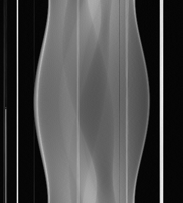
</div>
<div style="width: 50%; text-align: center;">
<p>After correction</p>
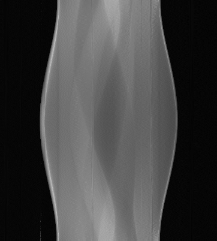
</div>
</div>

**Compare reconstructions:** reduce rings while preserving real structure.
Over-correction can introduce artefacts.

:::
::::

::: {.footer}
[HTTomolibGPU stripe removal](https://diamondlightsource.github.io/httomolibgpu/reference/methods_list/stripe_removal_methods.html)
· [Stripe-removal approaches: Sarepy](https://sarepy.readthedocs.io/toc/section3.html)
:::

## Exercise 6: pre-processing (de-striping) {#exercise6}

### Removing stripes from sinograms

1. Use synthethic dataset `tomodata_synth.nxs` to remove **stripes** from the calibrated sinogram images.

2. Use pipeline from [Exercise 5](#exercise5) and add [remove_all_stripe](https://diamondlightsource.github.io/httomo-backends/api/httomolibgpu.prep.stripe.html) stripe removal to your pipeline after dezinger.

3. Add save result for the **`remove_all_stripe`** method.

4. Tweak some parameters like `snr` and `la_size` to see if there are any effect. 

5. Inspect the results and compare the sinograms before and after de-striping.


## Reconstruction in HTTomo {}

**Reconstruction estimates the sample's internal structure from projections measured at many angles.**

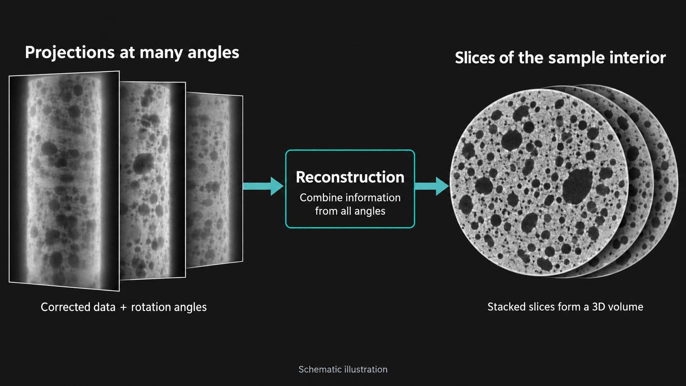{.nostretch width=90% height=430px style="object-fit: contain;" fig-alt="Many projection measurements and their angles are combined by a reconstruction algorithm to recover internal slices, which form a 3D volume."}

- **Inputs:** corrected and pre-processed projections, rotation angles and the centre of rotation.
- **In your YAML:** a reconstruction method, such as, `FBP3d_tomobar` or `LPRec3d_tomobar` should be added.
- **Output:** reconstructed slices forming a volume you can inspect and analyse.

::: {.notes}
Each projection contains overlapping information along X-ray paths.
Reconstruction combines the different views to estimate where attenuation
occurs inside the sample. One projection does not become one slice.
For the absorption reconstruction in this tutorial, the projections have
already undergone flat/dark correction and the negative logarithm.
The chosen backend library provides the reconstruction algorithm;
HTTomo manages its execution and data handling.
The illustration is schematic and was generated, not measured experimental data.
Introduce centre-of-rotation estimation in the following material.
:::

## 

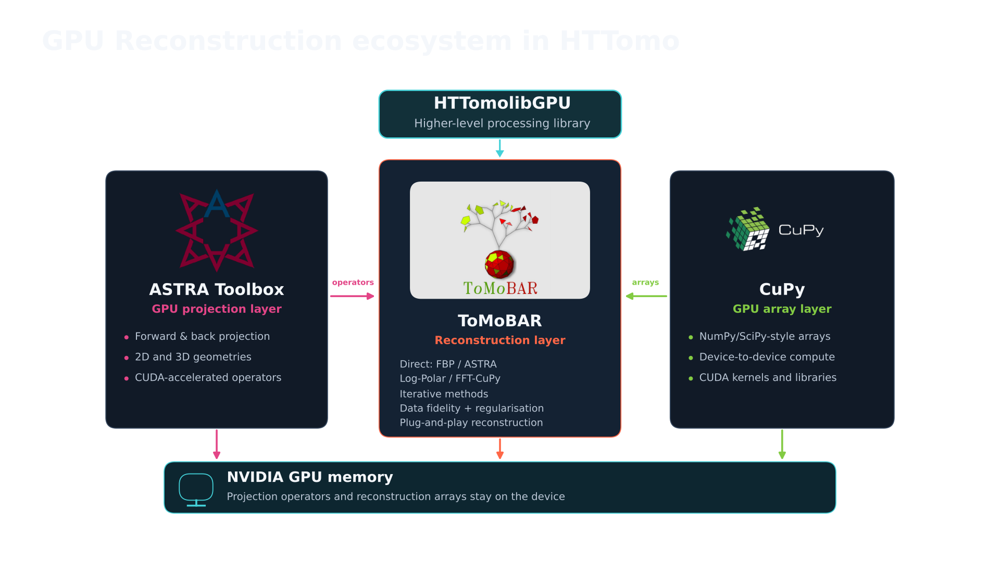{
  width=100%
  fig-alt="GPU reconstruction ecosystem"
}

## Reconstruction methods: direct and iterative

HTTomo calls **HTTomolibGPU** methods that use **ToMoBAR** for GPU reconstruction.

:::: {.columns}
::: {.column width="48%"}

### Direct methods

Compute the analytical reconstruction using an inversion formula:

- **`LPRec3d_tomobar`**  
  Direct Fourier inversion on log-polar grids. Fastest but sensitive to missing data.
- **`FBP3d_tomobar`**  
  Filtered backprojection through ASTRA-Toolbox backprojection. 


**Usually faster**, with fewer settings to tune.

:::

::: {.column width="2%"}
:::

::: {.column width="50%"}

::: {.fragment}
### Iterative methods

Repeatedly update an image estimate to improve agreement with the measured projections.

- **`SIRT3d_tomobar`**: simultaneous iterative reconstruction.
- **`CGLS3d_tomobar`**: conjugate-gradient least squares.
- **`FISTA3d_tomobar`** and **`ADMM3d_tomobar`**: optimisation methods with regularisation to control noise and preserve structure.

**More computation and tuning**, including iteration count and, where used, regularisation strength.
:::
:::
::::

All methods listed use **`module_path: httomolibgpu.recon.algorithm`**.

::: {.footer}
[HTTomolibGPU reconstruction templates](https://diamondlightsource.github.io/httomo-backends/api/httomolibgpu.recon.algorithm.html) ·
[ToMoBAR](https://github.com/dkazanc/ToMoBAR)
:::

## Exercise 7: reconstruction {#exercise7}

### Assessing the effect of de-zinging and de-striping on the reconstruction

1. Use synthethic dataset `tomodata_synth.nxs` and the pipeline from [Exercise 6](#exercise6).

2. Add the following reconstruction module as the last method in the pipeline:
```yaml
- method: LPRec3d_tomobar
  module_path: httomolibgpu.recon.algorithm
  parameters:
    center: null
    detector_pad: false
    filter_type: shepp
    filter_freq_cutoff: 1.0
    recon_size: null
    recon_mask_radius: 0.95
```

3. Run the pipeline and inspect the results. 

4. Perform reconstruction with dezinger switched off (commented).

5. Perform reconstruction with de-stripper switched off (commented).

## Centre of Rotation (CoR) estimation {#cor_estimation .small}

::: {.columns}
::: {.column width="50%"}

::: {style="text-align: center;"}
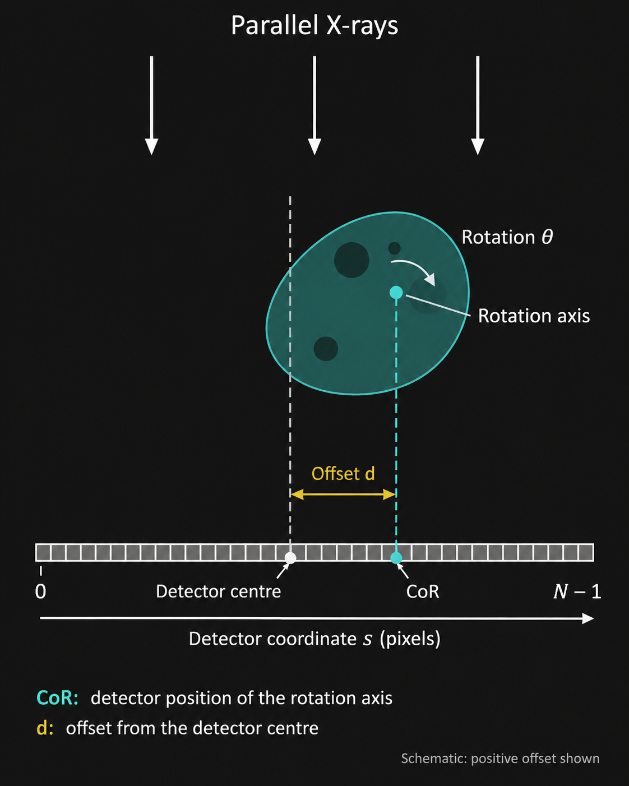{.nostretch height=470px fig-alt="Parallel-beam geometry showing the rotation axis projected onto the detector and its offset from the detector centre."}

:::

The **centre of rotation (CoR)** is the detector coordinate where the rotation axis projects, measured in pixels.

The offset $d$ measures its displacement from the detector centre. Estimate the CoR experimentally or computationally before reconstruction.

:::
::: {.column width="2%"}
<!-- empty column to create gap -->
:::

::: {.column width="48%"}

::: {.fragment}

### Methods for CoR estimation in HTTomo

1. Methods that rely on the rotational symmetry of a sinogram, such as [Find centre by N. Vo](#cor-search), or the alignment of projections using [phase cross-correlation](https://tomopy.readthedocs.io/en/stable/api/tomopy.recon.rotation.html#tomopy.recon.rotation.find_center_pc).
2. Methods that evaluate reconstruction-quality metrics, such as the [metrics-based finder](https://tomopy.readthedocs.io/en/stable/api/tomopy.recon.rotation.html#tomopy.recon.rotation.find_center).
3. Manual search using HTTomo's [parameter-sweeping functionality](#sweeping).
:::
:::
:::

::: {.footer}
[Details on CoR](https://diamondlightsource.github.io/httomo/howto/httomo_features/centering.html)
:::

## Finding the centre of rotation using N. Vo method {#cor-search}

<video data-autoplay loop muted playsinline controls preload="auto" poster="images/cor-search-poster.png" style="display:block; width:90%; margin:0 auto;">
<source src="images/cor-search.mp4" type="video/mp4">
</video>

::: {style="font-size: 0.5em;"}
Synthetic demonstration based on [Vo et al., Optics Express 2, (2014)](https://doi.org/10.1364/OE.22.019078).
:::

## {#wrappers}

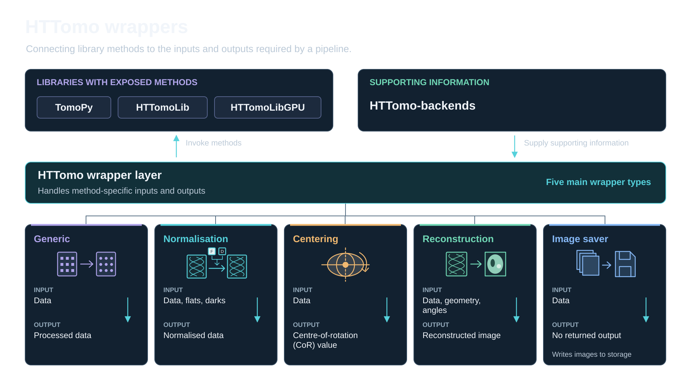{
  width=100%
  fig-alt="HTTomo wrappers"
}

## Side outputs {#side-outputs .small}

A [side output](https://diamondlightsource.github.io/httomo/howto/httomo_features/side_out.html#side-output) is an additional result that certain methods provide through specific [wrappers](#wrappers). A later method can use that result in the same pipeline.

Example: [HTTomo auto-centering](https://diamondlightsource.github.io/httomo/howto/httomo_features/centering.html#auto-centering) produces a **centre-of-rotation value** that reconstruction uses automatically.

:::: {.columns}
::: {.column width="52%"}

### Using side outputs in YAML

```{.yaml code-line-numbers="12-14|20"}
# After pre-processing: estimate the CoR
- method: find_center_vo
  module_path: httomolibgpu.recon.rotation
  parameters:
    ind: mid
    smin: -50
    smax: 50
    srad: 6
    step: 0.25
    ratio: 0.5
    drop: 20
  id: centering
  side_outputs:
    cor: centre_of_rotation

# Reconstruction using the estimated CoR
- method: FBP3d_tomobar
  module_path: httomolibgpu.recon.algorithm
  parameters:
    center: ${{centering.side_outputs.centre_of_rotation}}
    filter_freq_cutoff: 1.1
    recon_size: null
    recon_mask_radius: null
```

:::
::: {.column width="2%"}
:::
::: {.column width="45%"}

### How the reference works

1. **Provide an ID**, e.g., `id: centering`.

2. **Name its result**  
   `cor` is the exposed output key.  
   `centre_of_rotation` is the name you assign to it.

3. **Use it as a parameter**  
   `${{…}}` tells HTTomo to resolve the reference at runtime and supply the calculated value to `center`.

::: {.callout-note style="font-size: 1.2em;"}
**Method order matters:** place auto-centering before reconstruction but after d/f correction.
:::
:::
::::

## Exercise 8: reconstruction with auto-centering {#exercise8 .small}

Use real data `lorentz_data.h5` to perform d/f correction, auto-centering and reconstruction.

1. Use the pipeline from [Exercise 3](#exercise3). 

Build a pipeline with the modified YAML [loader](#preview_lorentz).
2. Add d/f correction and negative logarithm. 
3. Add the `find_center_vo` method by using the [YAML template](https://diamondlightsource.github.io/httomo-backends/api/httomolibgpu.recon.rotation.html) for it.
4. Add the reconstruction method `FBP3d_tomobar` or `LPRec3d_tomobar` using provided [YAML template](https://diamondlightsource.github.io/httomo-backends/api/httomolibgpu.recon.algorithm.html).

::: {.callout-note}
Note that `center` in `parameters` points to the [side output](#side-outputs) of the `find_center_vo` method by default.
```{.yaml code-line-numbers="2"}
  parameters:
    center: ${{centering.side_outputs.centre_of_rotation}}
    detector_pad: false
    filter_freq_cutoff: 0.35
    recon_size: null
    recon_mask_radius: 0.95
```
:::

## Reconstruction settings: padding, masking and filters {.smaller}

:::: {.columns}
::: {.column width="50%"}

### Padding and masking (relevant to all methods)

**`detector_pad: true`** extends both horizontal detector edges before reconstruction to reduce boundary and halo artefacts in the reconstruction.

**`recon_mask_radius: 0.9`** applies a circular mask after reconstruction, setting values outside it to zero.

**`recon_size: null`** change the size of the reconstruction in pixels. Use when the sample if well withing the field of view.

<div style="display: flex; gap: 12px; align-items: flex-start;">
<div style="flex: 1; min-width: 0; text-align: center;">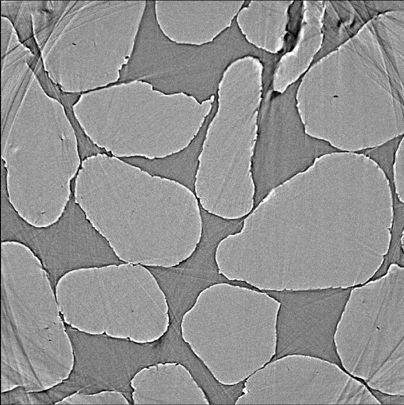<p style="font-size: 20px; text-align: center;">No padding</p></div>
<div style="flex: 1; min-width: 0; text-align: center;">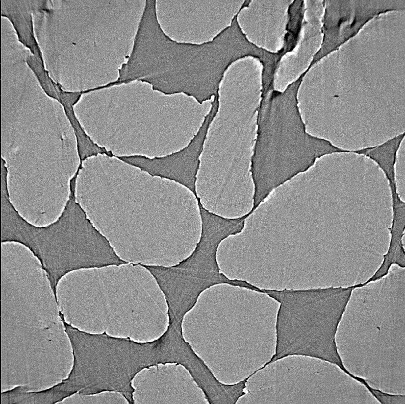<p style="font-size: 20px; text-align: center;">Padding enabled</p></div>
<div style="flex: 1; min-width: 0; text-align: center;">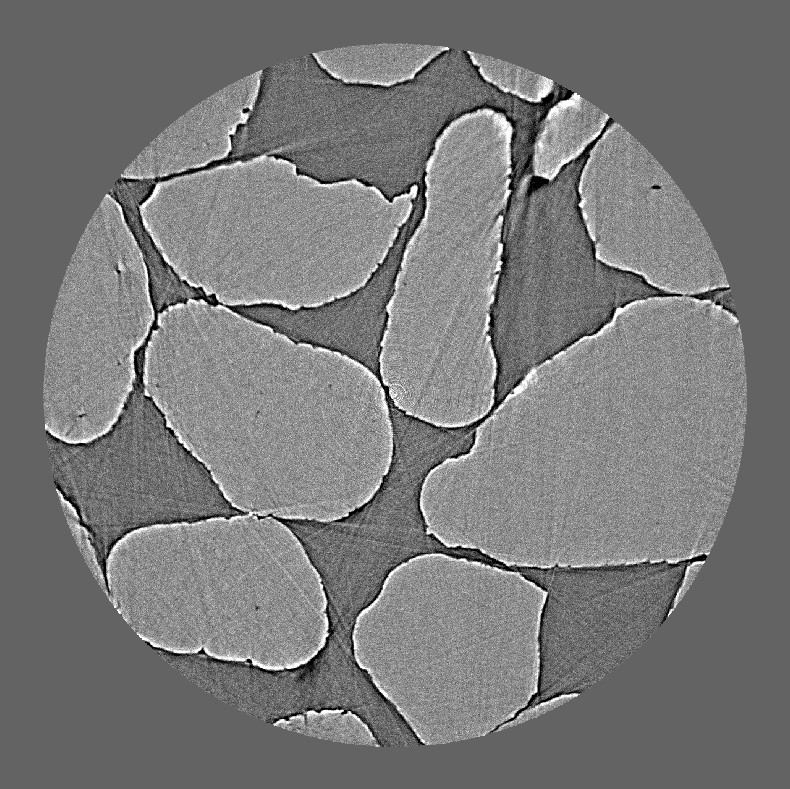<p style="font-size: 20px; text-align: center;">Padding + mask 0.9</p></div>
</div>

Masking hides the outer region; it does not repair the data there.

:::
::: {.column width="50%"}

::: {.fragment}
### Filters (based on **`LPRec3d_tomobar`**)

**`filter_type`** selects the frequency weighting, for example `ramp`, `shepp`, `hann` or `parzen`.

**`filter_freq_cutoff`** sets the frequency cut-off. Adjusting it changes the balance between fine detail and noise.

<div style="display: flex; gap: 12px; align-items: flex-start;">
<div style="flex: 1; min-width: 0; text-align: center;"><p style="font-size: 20px; text-align: center;">hann, cut-off 1.0</p></div>
<div style="flex: 1; min-width: 0; text-align: center;">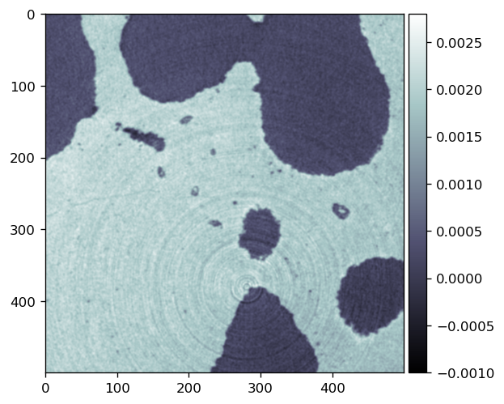<p style="font-size: 20px; text-align: center;">parzen, cut-off 1.0</p></div>
</div>

:::
:::
::::

::: {.footer}
[Descriptions and figures: HTTomolibGPU LPRec3d_tomobar](https://diamondlightsource.github.io/httomolibgpu/reference/methods_list/reconstruction/LPRec3d_tomobar.html)
:::

## Exercise 9: changing reconstruction parameters {#exercise9 .small}

1. Based on pipeline from [Exercise 8](#exercise8), change the reconstruction parameters and inspect the differences: 

```{.yaml}
    detector_pad: true # false
    recon_mask_radius: 2.0 # 0.9 is default
    recon_size: null # set to an integer, e.g., 500
```

## Why rescale data before saving images?

**Rescaling maps floating-point values into an integer image range.**

- **Choose the image bit depth:** unsigned 8-, 16- or 32-bit values with `bits`.
- **Reduce storage:** fewer bits per pixel mean smaller uncompressed images.
- **Control contrast:** map a selected intensity range across the available grey levels.

::: {.fragment}

**Reconstruction → `rescale_to_int` → `save_to_images`**

Rescaling prepares the image values; the saving method writes the files.
:::

::: {.footer}
[HTTomolibGPU rescale_to_int](https://diamondlightsource.github.io/httomolibgpu/reference/methods_list/rescale/rescale_to_int.html)
:::

## Choosing the rescaling range {#rescaling-range}

`perc_range_min` and `perc_range_max` select **percentages of the minimum-to-maximum intensity range**, not histogram percentiles.

:::: {.rescaling-examples}
::: {.rescaling-example}
**0–100%: full input range**

{.nostretch fig-alt="Projection rescaled using the full input intensity range."}
:::

::: {.rescaling-example}
**10–90%: improved contrast in this example**

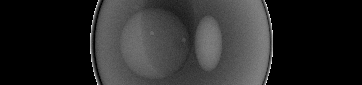{.nostretch fig-alt="The same projection rescaled using 10 to 90 percent of its intensity range."}
:::

::: {.rescaling-example}
**30–70%: excessive clipping loses detail**

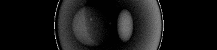{.nostretch fig-alt="The same projection with detail lost through an overly narrow scaling range."}
:::
::::

::: {.callout-warning style="font-size: 1.4em;"}
Keep the original **floating-point reconstruction** for quantitative analysis.
Integer conversion loses precision; values outside the selected range are clipped.
:::

::: {.footer}
[Method and figures: HTTomolibGPU rescale_to_int](https://diamondlightsource.github.io/httomolibgpu/reference/methods_list/rescale/rescale_to_int.html)
:::


## Exercise 10: saving images {#exercise10 .small}

Adding data rescaling and image saving to pipelines from [Exercise 8](#exercise8).

**After** the reconstruction step add the following YAML code: 

```yaml
# calculating statistics globally (min/max)
- method: calculate_stats
  module_path: httomo.methods
  parameters: {}
  id: statistics
  side_outputs:
    glob_stats: glob_stats
# rescaling data
- method: rescale_to_int
  module_path: httomolib.misc.rescale
  parameters:
    perc_range_min: 1.0  # percentage min
    perc_range_max: 99.0 # percentage max
    bits: 16 # 8 or 32
    glob_stats: ${{statistics.side_outputs.glob_stats}}
# saving rescaled images
- method: save_to_images
  module_path: httomolib.misc.images
  parameters:
    subfolder_name: images
    axis: auto
    file_format: tif
    asynchronous: true
```

::: {.note}
These methods are the CPU methods and accessed from `httomo.methods` and `httomolib.misc` library.
:::

::: {.footer}
[Real data examples in HTTomo documentation](https://diamondlightsource.github.io/httomo/howto/tutorial/real_data_example.html)
:::

## Interpreting HTTomo logs

:::: {.columns}
::: {.column width="31%"}

### Log outputs

| Output | What it tells you |
|:--|:--|
| **Terminal (stdout)** | Concise run status and progress |
| **`user.log`** | The same concise information, saved to file |
| **`debug.log`** | More detailed information for debugging |

:::
::: {.column width="2%"}
<!-- empty column to create gap -->
:::
::: {.column width="67%"}


::: {.fragment}

### Reading the sections

1. **`Pipeline has been separated into N sections`**   HTTomo groups methods into [sections](#sections) that process data blocks.
2. **Loader runs first, outside the sections.**   It loads data in projection `pattern` (see [reslice](#reslice)), which the first section also uses.
3. **`Section N with the following methods`**   The listed methods run sequentially on each block. The section processes all its input before the next section starts.
4. **`Finished processing the last block`**   The current section has finished. Another section may follow.

::: {.reading}
**Example:** `1/2` means one of two blocks completed in this section (**50%**). Elapsed/remaining times and `s/block` describe section progress. Faster processing may use `block/s`.
:::

:::
:::
::::

::: {.footer}
[Interpret logs in HTTomo](https://diamondlightsource.github.io/httomo/howto/interpret_logger.html)
:::

## {#sections}

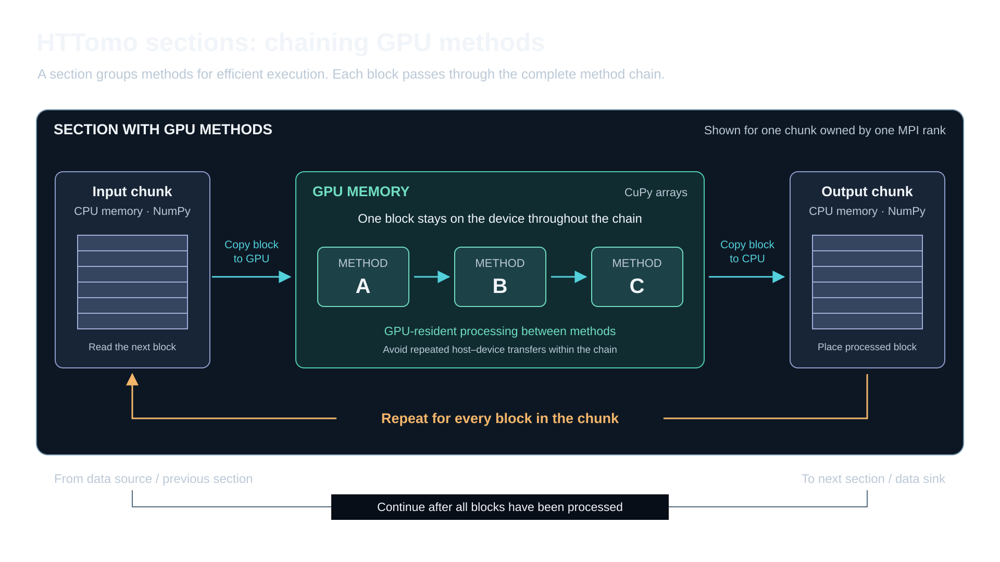{
  width=100%
  fig-alt="HTTomo GPU section"
}

::: {.footer}
[More on sections](https://diamondlightsource.github.io/httomo/introduction/concepts/sections.html)
:::

## Sweeping functionality {#sweeping .small}

:::: {.columns}
::: {.column width="54%"}

### What is it

[HTTomo parameter sweeping](https://diamondlightsource.github.io/httomo/howto/httomo_features/parameter_sweeping.html) runs a method on the same input data using several values of one parameter, allowing you to compare the results and choose a suitable value.


::: {.fragment}

### When to use

Parameter sweeping is useful when automatic estimation fails or is unavailable. For example, if an automatic method cannot reliably estimate the [center of rotation](#cor_estimation), sweeping lets you compare reconstructions and select a suitable value.

:::

::: {.fragment}

### HTTomo feature

Parameter sweeping uses a separate runner in HTTomo, designed for debugging and parameter tuning rather than high-throughput processing. No changes from the user perspective. The users run **sweep** pipelines excactly the same as HT pipelines.
:::
:::
::: {.column width="45%"}

::: {.fragment}

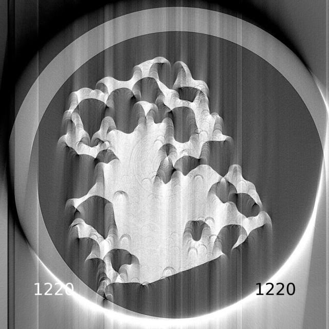{
  width=85%
  fig-alt="CoR sweeping"
}

::: {.caption}
Changing CoR changes the reconstruction. Each frame shows its trial value.
:::

:::

:::
::::


## HTTomo parameter sweeping feature {#sweep_syntax}

Run a method with several values of **one** parameter.

:::: {.columns}
::: {.column width="48%"}

### YAML syntax

**Range of values** (under `parameters:`) for the `center` parameter:

```yaml
center: !SweepRange
  start: 10
  stop: 50
  step: 10
```

Tests **10, 20, 30, 40**.

**Explicit values** given for the `size` parameter:

```yaml
size: !Sweep
  - 3
  - 5
```

:::
::: {.column width="2%"}
<!-- empty column to create gap -->
:::
::: {.column width="50%"}

::: {.fragment}
### Setup and results

- Define **one sweep per pipeline**.
- Use loader `preview` to select few vertical slices.
- HTTomo saves sweep results as images **automatically**. No image-saving or rescaling methods are needed after the sweep.
- Each trial contributes its **middle slice** to the output, stacked along the middle dimension.
:::
:::
::::

::: {.footer}
[HTTomo parameter sweeping guide](https://diamondlightsource.github.io/httomo/howto/httomo_features/parameter_sweeping.html)
:::

## Exercise 11: sweeping for CoR {#exercise11 .small}

Perform a **sweep** run for the [center of rotation](#cor_estimation) parameter using the YAML syntax [provided](#sweep_syntax). 

1. Use real data **`lorentz_data.h5`** and the pipeline from [Exercise 8](#exercise8), but remove `find_center_vo` method from it. Note that rescaling and image saving from [Exercise 10](#exercise10) are not needed when `sweep` is used. 

2. Add the `!Sweep` or `!SweepRange` tag to the `center` parameter in the reconstruction method. It is recommended to sweep around 1200 pixels, which is the approximate centre of the detector.

3. Inspect the sequence of images produced by the sweep run. Choose visually a more suitable value for the CoR parameter.

4. Compare it with the automatically found value of the [Exercise 8](#exercise8). You can find it in the logs.

## Tutorial II:  running end-to-end pipelines on Diamond HPC 

- Cluster configuration and job submission at Diamond
- Running full pipelines for 180 degree rotation scans
- Distortion correction and phase contrast pre-processing
- Introduction to 360 extended (aka double) field of view DFoV scans
- Running full pipelines for 360 degree extended field of view scans
- Continuous (4D) in-situ scans

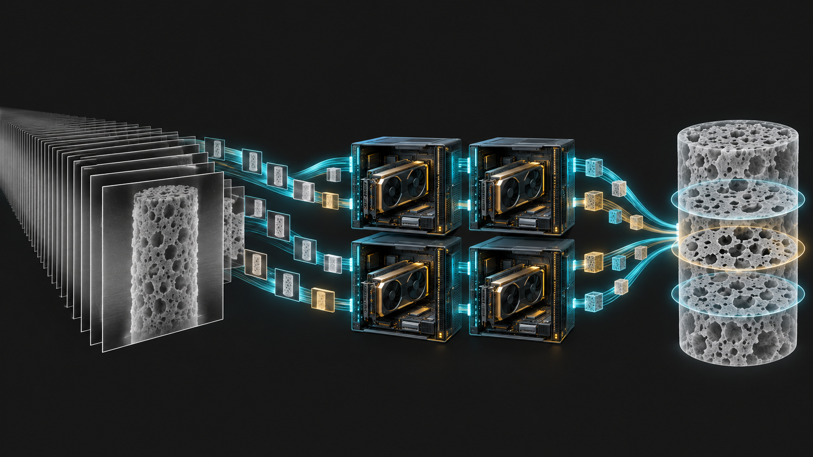{.nostretch width=45%}

## Wilson: running jobs with SLURM 

**Wilson** is Diamond’s compute cluster. **SLURM** allocates resources,
queues jobs and starts them when the requested resources become available.

### A typical workflow

1. **Connect to the cluster:** `ssh wilson` with `fedid` and password.
2. **Submit:** send your job to the queue with `httomo_mpi`.
3. **Monitor:** check whether it is waiting or running (optional).
4. **Tail:** tail the job with `tail -f <jobID>` 
5. **Inspect:** when it finishes, open the output and results.

| Command | What it does |
|---|---|
| `tail -f <jobID>` | Tailing the submitted job. If nothing shows up after 30 seconds, then check the status of the job with `squeue` |
| `squeue -u $USER` | Show your queued and running jobs. |
| `scancel <jobID>` | Cancel one of your queued or running jobs. |
| `sacct -j <jobID>` | Show job accounting, including completed jobs. |

::: {.footer}
[Submitting HTTomo jobs to Diamond cluster](https://confluence.diamond.ac.uk/spaces/SSCC/pages/362619300/Submitting+HTTomo+jobs+to+Diamond+cluster)
:::

## HPC processing - one cluster node

### Using four NVIDIA RTX PRO 6000 Blackwell GPUs

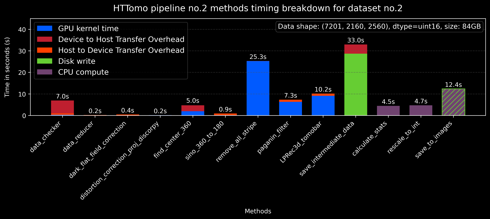{
  .nostretch
  width=90%
  fig-alt="Blackwell 4 GPUs run"
  fig-align="center"
}

## HPC processing - multinode

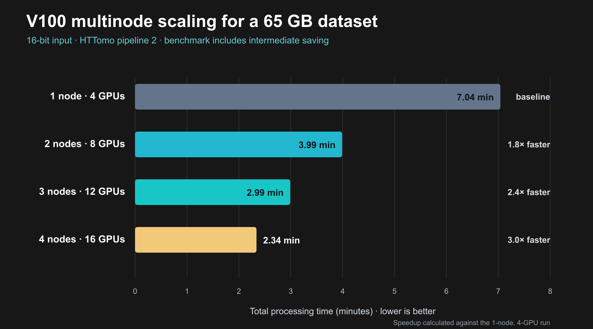{
  .nostretch
  width=80%
  fig-alt="V100 multinode"
  fig-align="center"
}

## Exercise 12: Building a full pipeline {#exercise12 .small}

1. Build the full pipeline for the real data `sandstone.nxs`. 

2. Include previously discussed pre-processing (dezingering, stripe removal), auto-centering, reconstruction steps, rescaling data and saving into tiffs.

3. Note that this data follows NXTomo conventions, so you can use the `auto` keyword in the loader, see more about the [loader](#loader).

4. To avoid long processing times, you can use the `preview` option in the loader to select a **hundred** of vertical slices in the middle of the detector.

5. You can also switch off the saving of the resconstructed image into HDF5 file with `save_result: false` added.

## Distortion correction: minimising optical distortions {.smaller}

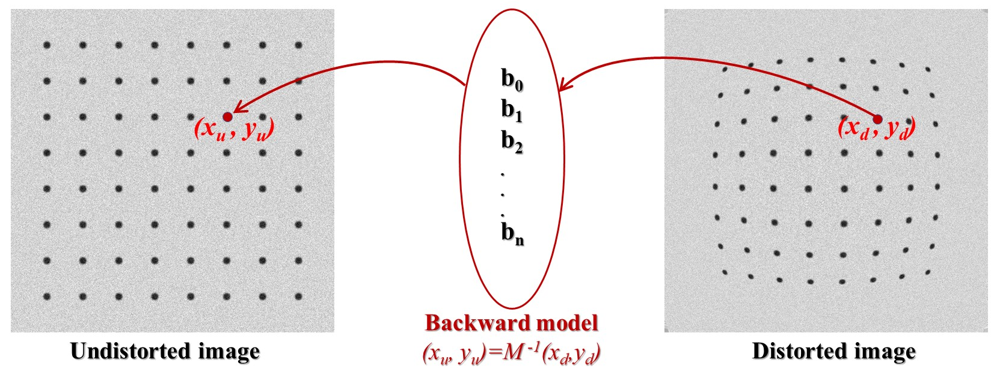{.nostretch width=90% height=310px fig-alt="Discorpy example: a distorted dot grid on the right maps to an undistorted grid with straight rows and columns on the left." style="object-fit: contain;"}

**Right: distorted grid. Left: undistorted grid.** The calibration model maps between them.

:::: {.columns}
::: {.column width="46%"}

### Why does it matter?

Detector optics can bend straight features and shift their positions.
These geometry errors can cause reconstruction artefacts and shape errors.

**Flat/dark correction adjusts intensity; distortion correction adjusts positions.**

:::
::: {.column width="2%"}

<!-- empty column to create gap -->
:::
::: {.column width="46%"}

### Correction in two steps

1. **Calibrate:** image a known dot or line pattern to obtain correction coefficients. Usually performed before the experiemnt, and only once for a given detector configuration.
2. **Unwarp:** resample each projection onto a corrected grid using the calibration coefficients **before** reconstruction.
:::
::::

::: {.footer}
[Image and method: Discorpy documentation, Fig. 2.2.1.2](https://discorpy.readthedocs.io/en/latest/tutorials/methods.html)
:::

::: {.notes}
A calibration target provides known geometry that reveals how the imaging
system displaces points. Discorpy supports radial distortion calibration
and can account for perspective effects in the calibration image.
Perspective caused by a tilted calibration target must be distinguished
from the lens distortion to be corrected in tomography projections.
Use calibration parameters appropriate to the detector configuration.
Calibration estimates the model; applying it to projections is a separate step.
This correction does not replace flat/dark correction or centre-of-rotation estimation.
:::


## Distortion correction: before and after {.smaller}

Correcting projection geometry improves the reconstructed image.

:::: {.columns}
::: {.column width="48%"}

### Before correction

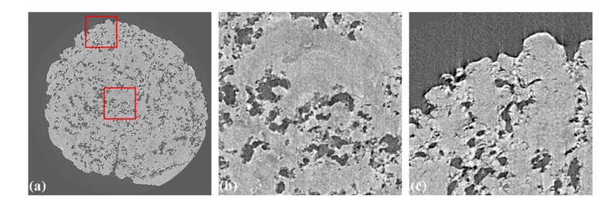{.nostretch width=100% height=260px fig-alt="reconstruction before distortion correction, with central and edge magnifications. Streak artefacts are particularly visible near the edge." style="object-fit: contain;"}

Streaks become stronger towards the **edge** of the reconstruction. Compare the central detail **(b)** with the edge detail **(c)**.

:::
::: {.column width="48%"}

### After correction

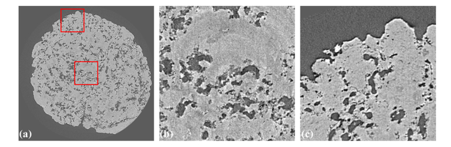{.nostretch width=100% height=260px fig-alt="reconstruction after distortion correction, with corresponding central and edge magnifications. The edge detail shows reduced streaking and clearer boundaries." style="object-fit: contain;"}

The corresponding edge detail **(c)** shows **reduced streaking and clearer boundaries** after correcting the projections.

:::
::::

::: {.footer}
[Vo, Atwood & Drakopoulos (2019), *Preprocessing techniques for removing artifacts in synchrotron-based tomographic images*](https://doi.org/10.1117/12.2530324).
:::

::: {.notes}
Both figures show reconstructed slices, not raw projections. Panel (a) gives
the full slice; the red boxes locate the magnified central region (b) and
edge region (c). Ask learners to compare panel (c) on the left and right.
Radial lens distortion grows with distance from the optical axis, so its
reconstruction artefacts are often more pronounced near the image edge.
The correction is applied to the projection images before reconstruction.
These are published examples from Vo et al., not a new HTTomo benchmark.
The supplied figure images are reproduced without altering their pixels.
:::


## Applying distortion calibration in HTTomo {.smaller}

:::: {.columns}
::: {.column width="48%"}

**Use the calibration file for your detector setup:**

```yaml
- method: distortion_correction_proj_discorpy
  module_path: httomolibgpu.prep.alignment
  parameters:
    metadata_path: /path/to/coefficients_bw.txt
    order: 3
    mode: constant
```

The text file contains **`xcenter`, `ycenter`, then `factor_0`, `factor_1`, …**, one value per line.

- **Centre:** the lens distortion centre in pixels, measured from the left and top. This is different from the rotation centre.
- **Coefficients:** fitted weights controlling radial resampling. Obtain the **backward-model** file from Discorpy calibration.

:::
::: {.column width="2%"}
:::

::: {.column width="48%"}

**What do the coefficients do?**

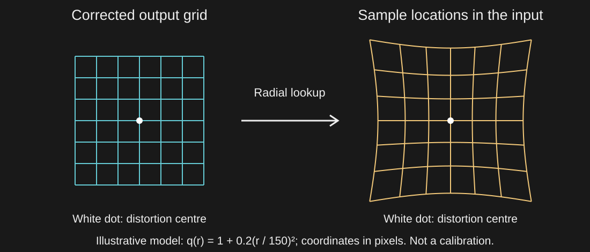{.nostretch width=100% fig-alt="A regular corrected image grid maps to radially displaced sample positions in the input using an illustrative polynomial."}

$$q(r_u)=b_0+b_1r_u+b_2r_u^2+\cdots,\qquad r_d=q(r_u)r_u$$

For each output pixel, look up a position in the original projection and interpolate its intensity.

**`b₀`** controls uniform radial scaling; the remaining terms make the scaling vary with distance from the distortion centre.

:::
::::

::: {.footer}
[Discorpy calibration example](https://github.com/DiamondLightSource/discorpy/blob/master/examples/example_01.py) ·
[Vo et al., 2019](https://doi.org/10.1117/12.2530324)
:::

::: {.notes}
Calibration is performed separately. example_01.py calls calc_coef_backward
and saves coefficients_bw.txt using save_metadata_txt. Use that backward
file rather than coefficients_fw.txt. The path on the slide is a placeholder.
The example also saves a corrected calibration image and residual plots
for checking the fit before applying it to projections.

The file parser reads the last whitespace-separated number on each line:
first xcenter, then ycenter, then the polynomial coefficients in ascending
power order. Labels written by Discorpy are accepted.

The formula follows httomolibgpu.prep.alignment directly. With coordinates
relative to the distortion centre, ru is the output radius and rd is the
radius of the sampled input location. xd = xc + q(ru)*(xu-xc), and similarly
for y. Interpolation fills a regular output grid. q=1 gives no displacement.
The schematic shows sampling coordinates, not a measured projection or a
forward push of input pixels. Its coefficients are illustrative only.

order: 3 specifies cubic interpolation, not polynomial degree. mode controls
interpolation boundary handling; the current implementation also clips
sampling coordinates to the input bounds. These coefficients describe radial
lens distortion, not a general perspective transform.

HTTomo supplies preview offsets through its distortion wrapper. Use calibration
for the appropriate original detector geometry; resizing or binning needs
consistent calibration. Apply correction before reconstruction.
:::

## Exercise 13: Apply distortion correction {#exercise13 .small}

1. Use `tomographic_projections.hdf` dataset from the `dist_corr` folder.

2. Configure loader using explicit paths to data, d/f (note that there are in the additional files) and provide user-defined angles: 

```yaml
    rotation_angles:
      user_defined:
        start_angle: 0.0
        stop_angle: 180.0
        angles_total: 1801
```

3. Add [distortion correction](https://diamondlightsource.github.io/httomo-backends/api/httomolibgpu.prep.alignment.html) method after the loader with the following coefficients: 

<details>
<summary>distortion_correction_proj_discorpy with coefficients</summary>


```yaml
- method: distortion_correction_proj_discorpy
  module_path: httomolibgpu.prep.alignment
  parameters:
    metadata_path: null
    order: 1
    mode: reflect
    xcenter: 1230.99353849
    ycenter: 1018.86666868
    list_fact:
    - 1.00015857686
    - -1.00246012274e-06
    - -8.9859016203e-10
    - -2.31488898858e-12
    - 7.6288191801e-16
```
</details>

4. Add d/f correction, stripe removal, CoR finder method, negative log and recosntruction. Add vertical preview to save time. 

5. Compare reconstructions with and without distortion correction

## Phase contrast: Paganin filter {#paganin-filter .smaller}

Propagation creates bright/dark fringes at material boundaries. **Paganin phase retrieval** suppresses these fringes and noise before reconstruction, assuming an approximately **single-material** sample.

:::: {.columns}
::: {.column width="31%"}

**Reconstruction without Paganin filter**

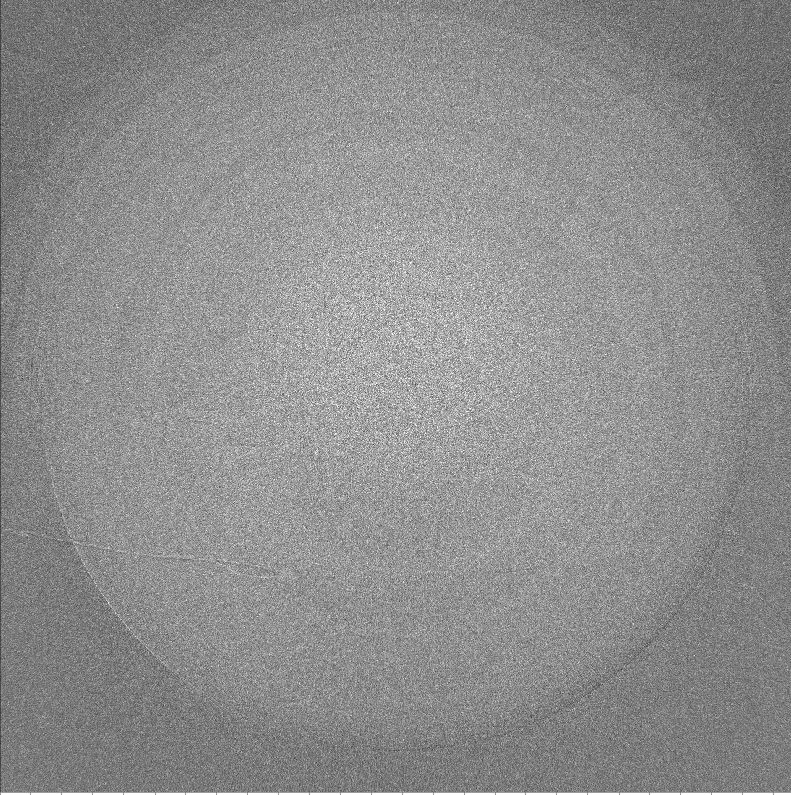{.nostretch width=100% height=300px style="object-fit: contain;" fig-alt="Bovine liver reconstruction without Paganin filtering: strong noise obscures internal structures."}

Noise obscures tissue structure.

:::
::: {.column width="31%"}

**Paganin filter using $\delta/\beta = 500$**

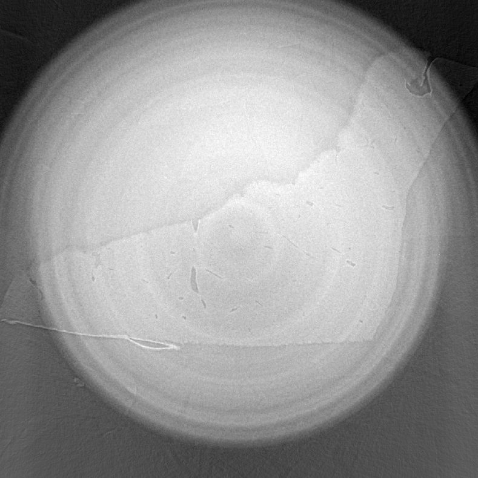{.nostretch width=100% height=300px style="object-fit: contain;" fig-alt="Bovine liver reconstruction with delta over beta of 500: reduced noise makes tissue boundaries easier to distinguish."}

Structure is easier to distinguish.

:::
::: {.column width="31%"}

**Paganin filter using  $\delta/\beta = 2000$**

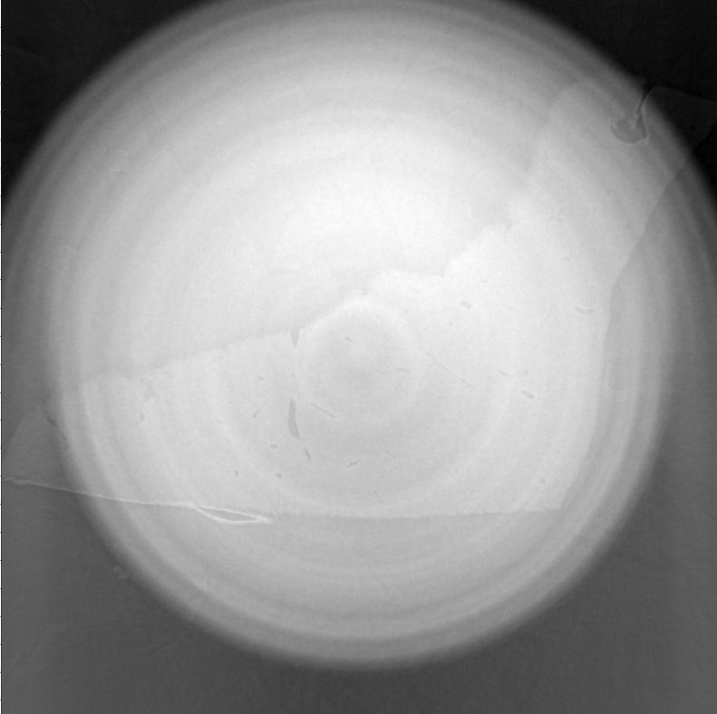{.nostretch width=100% height=300px style="object-fit: contain;" fig-alt="Bovine liver reconstruction with delta over beta of 2000: stronger filtering smooths fine detail."}

Too much filtering blurs detail.

:::
::::

**Parameters:** `pixel_size` (µm), `distance` (sample–detector, m), `energy` (keV), and `ratio_delta_beta` (phase-to-absorption ratio). A larger ratio gives stronger smoothing.

**Pipeline:** dark/flat correction → `paganin_filter` → reconstruction. **Omit `minus_log`: the filter includes it.**

::: {.footer}
[HTTomolibgpu phase contrast guide](https://diamondlightsource.github.io/httomolibgpu/reference/methods_list/phase_contrast_methods.html) [Paganin et al. (2002)](https://doi.org/10.1046/j.1365-2818.2002.01010.x)
:::

::: {.notes}
X-rays undergo both attenuation and phase shifts. Free-space propagation
converts phase variations into intensity fringes. Paganin retrieval uses a
physical model to recover a projected signal from a single propagation distance.
The original method assumes a homogeneous object, equivalently a constant
delta/beta ratio; interfaces between very different materials may be blurred
or imperfectly recovered. Delta is the refractive-index decrement and beta
the absorption index. Their ratio depends on material and beam energy.
:::


## Exercise 14: Apply the Paganin filter {#exercise14}

1. Use the pipeline and data from the previous [Exercise 13](#exercise13) and make vertical preview at least 100 slices or more. 

2. Instead of `minus_log` method add Paganin filter as shown bellow:
```yaml
- method: paganin_filter
  module_path: httomolibgpu.prep.phase
  parameters:
    pixel_size: 32.4       # µm
    distance: 3.2          # m
    energy: 53.0           # keV
    ratio_delta_beta: 200
```

3. Compare to the result of [Exercise 13](#exercise13). 


## A 360° scan, why we need it? {#why-360-scans .smaller}

**The sample may be wider than the detector’s field of view.** Moving the rotation axis towards one edge of the detector lets opposite views cover complementary parts of the sample.

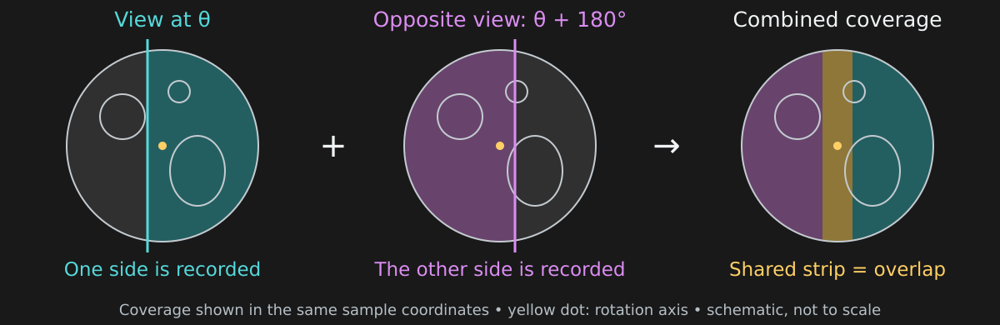{.nostretch width=100% height=350px fig-alt="An offset scan records one side of a sample at an angle theta and the complementary side at theta plus 180 degrees. Their shared strip allows alignment and stitching into a wider view."}

- **Collect a full turn:** each view has a partner 180° later that records the other side.
- **Join the paired views:** flip, align and blend their overlap to form a wider **180° dataset**.
- **Gain coverage:** approach **twice the detector width**, minus the overlap, without increasing pixel size.

A conventional **180° scan is sufficient when the whole sample fits** in the field of view in parallel-beam tomography. The extra coverage comes from **offsetting the axis and scanning 360° together**.

::: {.footer}
[Vo et al. (2021), §2.1.1: scans with an offset centre of rotation](https://doi.org/10.1364/OE.418448)
:::

::: {.notes}
This is the half-acquisition or extended-field-of-view approach in the supplied
paper. The schematic maps both views back into the same sample coordinates;
it does not show the literal orientation of the detector at the second angle.
A centred full-field 360-degree scan supplies redundant opposite views and
does not by itself double coverage. For a detector width W and overlap O,
the ideal stitched width is 2W-O. Some overlap is needed for reliable alignment.
The benefit is larger sample coverage at the existing pixel sampling; actual
spatial resolution still depends on the imaging system and processing.
For the same angular step, a full turn requires roughly twice the projections,
and hence more acquisition time and dose than a half turn with identical
exposures. This simple comparison assumes a static sample and parallel beams.
:::


## 360° to 180° scans conversion  {#360scan-video}

<video data-autoplay loop muted playsinline controls preload="auto" poster="videos/360-to-180-poster.png" style="display:block; width:80%; margin:0 auto;">
<source src="videos/360-to-180-tomography.mp4" type="video/mp4">
</video>

::: {style="font-size: 0.5em;"}
Synthetic demonstration based on [Vo et al., Optics Express 29, 17849–17874 (2021), §2.1.1.1 and Fig. 1](https://doi.org/10.1364/OE.418448).
:::


## Processing a 360° scan in HTTomo {#processing-360 .smaller}

**Correct the projections → find the overlap → convert to 180° → reconstruct**

:::: {.columns}
::: {.column width="44%"}

### 1. Step `find_center_360`

Compares opposite views to estimate the **centre_of_rotation**, **overlap**, **side** and **overlap_position**. It measures the geometry; it does not stitch the data.

### 2. Step `sino_360_to_180`

Uses the measured `overlap` and `side` to **flip, align and blend** the two angular halves into wider sinograms. 

### 3. Reconstruct the stitched data

Use the estimated **centre_of_rotation**

:::
::: {.column width="54%"}

**Two connected steps in your YAML**

```yaml
- method: find_center_360
  module_path: httomolibgpu.recon.rotation
  id: centering
  side_outputs:
    cor: centre_of_rotation
    overlap: overlap
    side: side
    overlap_position: overlap_position

- method: sino_360_to_180
  module_path: httomolibgpu.misc.morph
  parameters:
    overlap: ${{centering360.side_outputs.overlap}}
    side: ${{centering360.side_outputs.side}}

- method: LPRec3d_tomobar
  module_path: httomolibgpu.recon.algorithm
  parameters:
    center: ${{centering.side_outputs.centre_of_rotation}}    
```

:::
::::

::: {.footer}
[find_center_360 template](https://diamondlightsource.github.io/httomo-backends/api/httomolibgpu.recon.rotation.html) · [sino_360_to_180 template](https://diamondlightsource.github.io/httomo-backends/api/httomolibgpu.misc.morph.html)
:::


## Exercise 15: Perform 360° scan reconstruction {#exercise15}

1. Use data `bio_sample.nxs` from the folder **360**.

2. Use a standard loader template with the option for `auto` keys, angles and data. Make a vertical preview of 50 slices. 

3. Add `find_center_360` from [rotation templates](https://diamondlightsource.github.io/httomo-backends/api/httomolibgpu.recon.rotation.html) and `sino_360_to_180` from [morph templates](https://diamondlightsource.github.io/httomo-backends/api/httomolibgpu.misc.morph.html) into the pipeline. 

4. Add reconstruction and make sure the order is correct as shown in the [slide](#processing-360) above.

## Exercise 16: Sweep for the `overlap` parameter in 360° scan {#exercise16}

1. Using [parameter-sweeping functionality](#sweeping) perform a `!SweepRange` search for the overlap parameter.

2. Remove the `find_center_360` method from your pipeline and initiate a sweep in `sino_360_to_180`, e.g., like: 

```yaml
- method: sino_360_to_180
  module_path: httomolibgpu.misc.morph
  parameters:
    overlap: !SweepRange
      start: 1
      stop: 1300
      step: 10
    side: left # OR right, needs checking!
```

3. Find the `overlap` parameter choosing the correct `side` manually by assessing the overlap area in the stitched sinogram. Use ImageJ. 

4. Substitute the found value for `overlap` into parameters of `sino_360_to_180`, add negative log and a reconstruction method with `center: 2560`.


## Pipeline order: image quality and speed {#pipeline-order}

HTTomo executes methods **from top to bottom**. Order of methods affect the result as well as the runtime. 

:::: {.columns}
::: {.column width="48%"}

### Order affects the result
 
- **Dark/flat correction** should be the first methods after dezinger. 
- **Distortion correction** should be applied to the callibrated data.
- **Stripe removal**
- **Center finders** provide some supplementary data needed later in the pipeline
- Apply **Paganin filter** or **negative log** just before the reconstruction
- **Reconstruction**
- **Rescale to integers** 
- **Image saving**

:::
::: {.column width="48%"}

::: {.fragment}
### Order affects the runtime

- **Group data patterns:** projection methods together, then sinogram methods where valid. Each switch can require a costly [reslice](#reslice) of the distributed data.
- **Keep GPU methods together:** consecutive GPU methods keep data on the GPU, reducing CPU–GPU transfers. Mixing TomoPy and HTTomolibGPU methods is not ideal. 
- **Save only what you need:** unnecessary intermediate output adds disk traffic. For instance, if HDF5 is not needed, the result of the reconstruction can be skipped. 
:::
:::
::::

::: {.footer}
[HTTomo: optimise pipeline performance](https://diamondlightsource.github.io/httomo/howto/httomo_features/optimise_pipeline.html) · [Method patterns and implementations](https://diamondlightsource.github.io/httomo-backends/backends/method_info.html)
:::

## {#reslice}

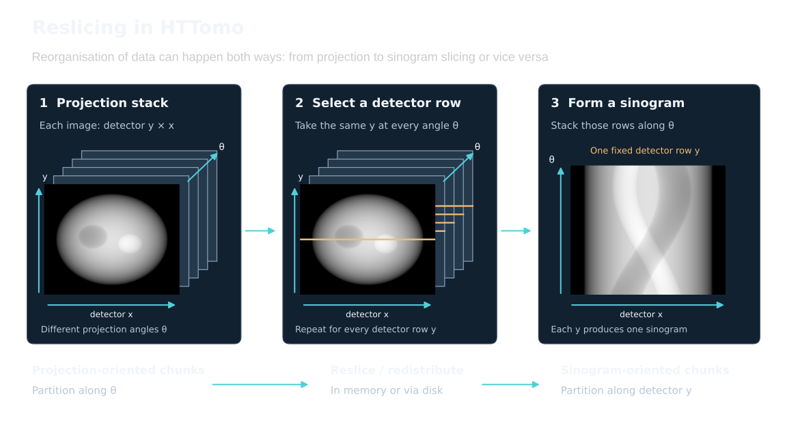{
  width=100%
  fig-alt="reslicing operation"
}

::: {.footer}
[More on reslice](https://diamondlightsource.github.io/httomo/introduction/concepts/reslice.html)
:::


## Debugging: inspect the intermediate results {#debugging-intermediates}

There are few ways to perform visual investigation of pipeline steps, if the reconstruction looks wrong. 

| Option | What is saved? | When to use it | Runtime burden |
|---|---|---|---|
| `--save-snapshots` | Representative **JPEG images** at selected pipeline stages | Quick visual checks; look in `pipeline_stages_snapshots/` inside the run folder. | Insignificant |
| `save_result: true` | The **processed dataset in HDF5** after a chosen method | Inspect a suspicious step in detail or check numerical values. | Medium |
| `--save-all` | Intermediate datasets for **every applicable task** | Trace the pipeline thoroughly; expect more disk use and a slower run. | Highest |


::: {.footer}
[Save intermediate datasets](https://diamondlightsource.github.io/httomo/howto/httomo_features/save_results.html) · [Run output and snapshots](https://diamondlightsource.github.io/httomo/reference/run_output.html)
:::


## Exercise 17: Build complete 360° pipeline {#exercise17 .smaller}

Build pipeline from scratch using the methods bellow. Use scan **191450.nxs**.

:::: {.columns}
::: {.column width="48%"}

| Step | Method, in execution order |
|---|---|
| 1 | `standard_tomo` |
| 2 | `remove_outlier` |
| 3 | `dark_flat_field_correction` |
| 4 | `distortion_correction_proj_discorpy` |
| 5 | `find_center_360` |
| 6 | `sino_360_to_180` |
| 7 | `remove_all_stripe` |
| 8 | `paganin_filter` |
| 9 | `LPRec3d_tomobar` |
| 10 | `calculate_stats` |
| 11 | `rescale_to_int` |
| 12 | `save_to_images` |

:::
::: {.column width="48%"}

### What must you configure?

1. **Loader:** use `auto` for NeXus paths and angles. Do the vertical preview to avoid longer runs, e.g., 200 slices. 
2. **Corrections:** copy the supplied distortion centre and coefficients. Set outlier and stripe-removal parameters from the reference YAML.
3. **Phase retrieval:** use **3 µm, 0.1 m, 15 keV**, with `ratio_delta_beta: 200`. **Do not add `minus_log`.**
4. **Output:** connect `calculate_stats` to `rescale_to_int`; use **16-bit**, percentages **1–99**, and save **TIFFs**.

Run the pipeline using `--save-snapshots` to inspect stitching and reconstruction.
:::
::::

::: {.footer}
[Method templates](https://diamondlightsource.github.io/httomo/backends/templates.html)
:::


<!--
####################################################
####################################################
########Tutorial III: Advanced concepts#############
####################################################
####################################################
-->


<!--
## {#mpi_figure}

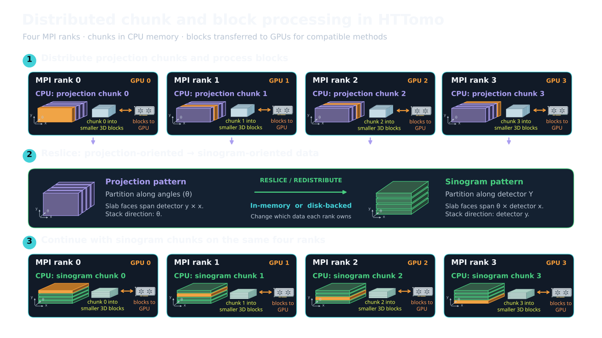{
  width=100%
  fig-alt="MPI in HTTomo"
}

::: {.footer}
[Benefits of using Open MPI in HTTomo](#openmpi-benefits)
:::


## 

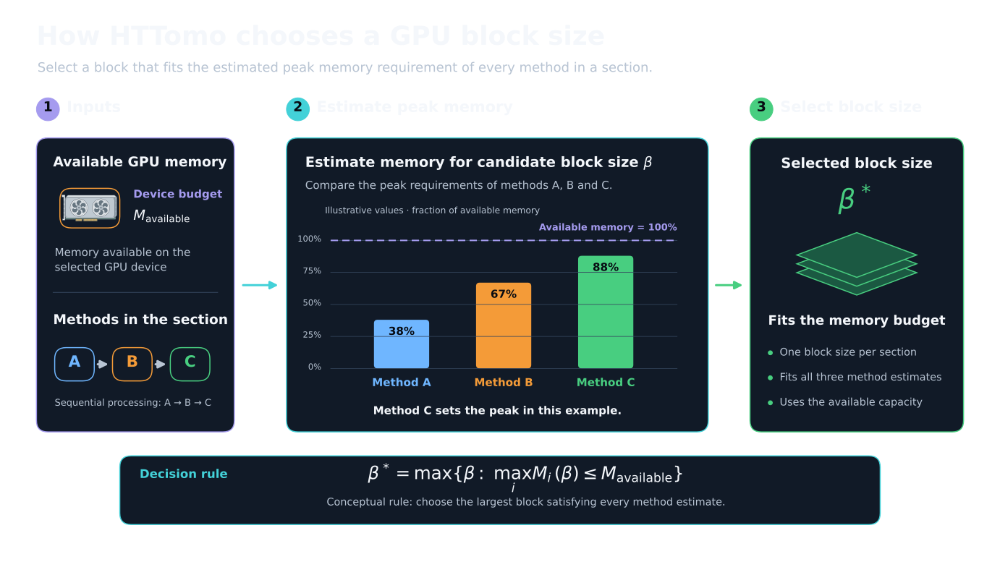{
  width=100%
  fig-alt="HTTomo GPU memory estimation"
}


::: {.footer}
[Enabling own methods in HTTomo](#own_methods)
:::

-->

##

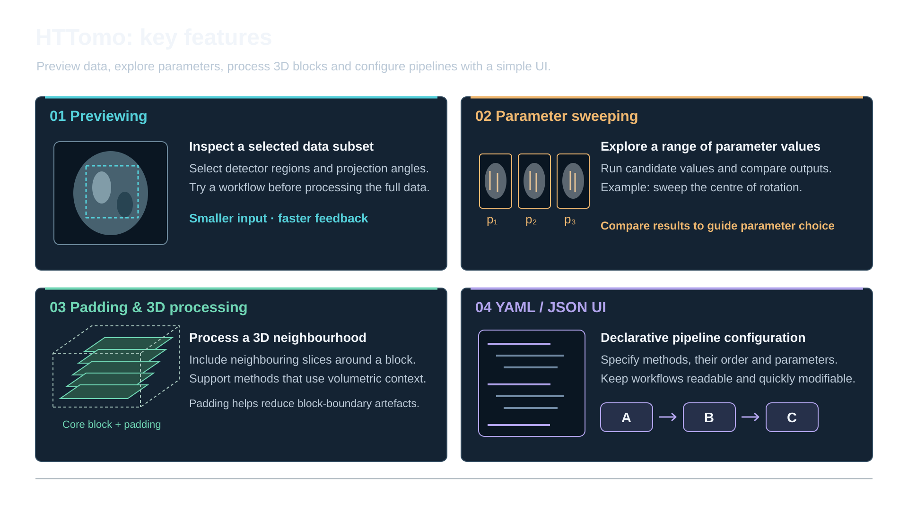{
  .nostretch
  width=90%
  fig-alt="HTTomo features"
}

::: {.footer}
[HTTomo features](https://diamondlightsource.github.io/httomo/howto/httomo_features.html)
:::

## HTTomo data-management directions {#gpu_data_management}

:::: {.columns}
::: {.column width="48%"}

### Larger 3D blocks within the memory budget

- HTTomo divides data **chunks** into 3D **blocks** for GPU processing.
- Blocks as large as safely fit in GPU memory
- Memory estimators use **free VRAM** and each method’s requirements to determine how many slices fit.
- The **most memory-demanding method in a section** limits the block size.

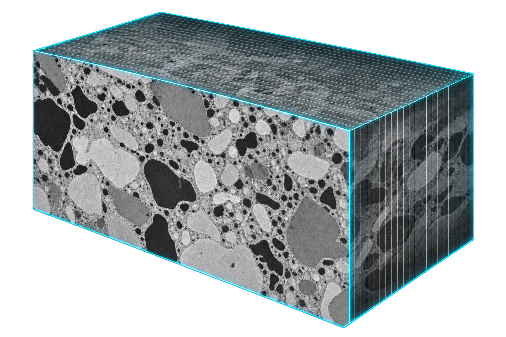{
  width=60%
  fig-alt="3d data block"
  fig-align="center"
}
:::
::: {.column width="2%"}
<!-- empty column to create gap -->
:::
::: {.column width="50%"}

::: {.fragment}
### Method chains to reduce transfers

HTTomo chains compatible GPU methods within a [section](#sections), keeping each block on the GPU between methods.

**For each block:**

1. Transfer the block to the GPU.
2. Run the GPU method chain.
3. Return the result to the CPU only when it is needed.

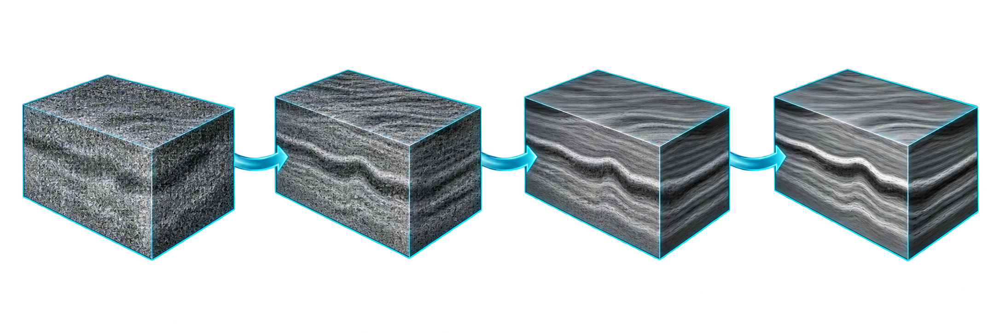{
  width=100%
  fig-alt="Chain of 3D processing methods"
  fig-align="center"
}
:::
:::
::::

## Padding enables true 3D processing

A 3D method needs neighbouring slices. Padding preserves that context when HTTomo splits a volume into blocks.

:::: {.columns}
::: {.column width="42%"}

### Why padding is needed

- A **2D method** processes each frame independently, so a block boundary does not interrupt its neighbourhood.
- A **3D method** uses information along all three axes. At a block edge, it needs slices held in the neighbouring block.
- HTTomo pads the block with this surrounding data, allowing the method to satisfy its boundary conditions and avoid seam-like artefacts.

:::
::: {.column width="58%"}

::: {.fragment}

### Denoising comparison

::: {.image-row}
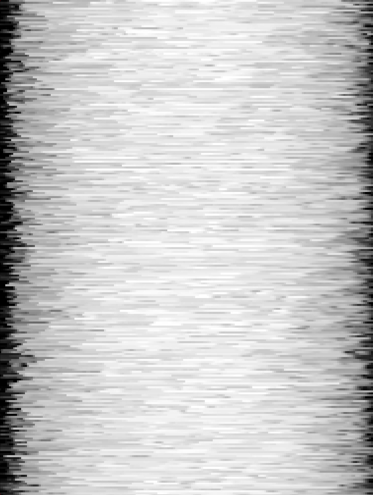{fig-alt="2D denoising" fig-align="center"}

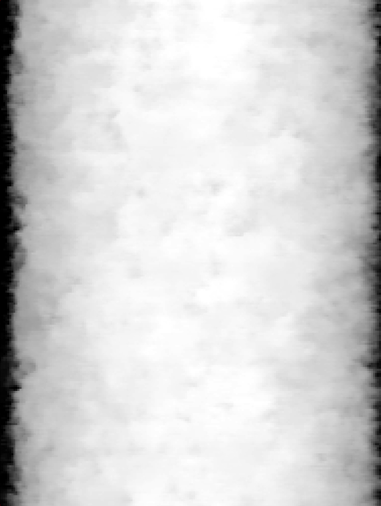{fig-alt="3D denoising" fig-align="center"}
:::

- Consistent resolution in all three dimensions
- Better removal of volumetric artefacts and improved contrast
- Access to advanced 3D filters and iterative reconstruction methods

:::
:::
::::

::: {.footer}
[HTTomo padding feature](https://diamondlightsource.github.io/httomo/howto/httomo_features/padding.html)
:::


## Acknowledgements

::: {.ack-intro}
HTTomo is a collective effort by software/method developers and beamline scientists at Diamond Light Source.
:::

:::: {.columns .ack-columns}
::: {.column width="22%"}

### Software developers:

- **Daniil Kazantsev**
- **Yousef Moazzam**
- **Naman Gera**
- **Jessica Verschoyle**
- **Timothy Poon**
- **Benedikt Daurer**

:::
::: {.column width="44%"}

### Beamline community

We thank Diamond’s beamline scientists for:

- Representative datasets and scientific requirements
- Software testing and validation on real experiments
- Feedback that improves methods, pipelines and usability

:::
::: {.column width="33%"}

### Diamond Light Source

We acknowledge Diamond Light Source and its technical teams for providing:

- Beamline and experimental facilities
- HPC and GPU computing resources
- Data infrastructure and operational support

:::
::::

::: {.footer}
Thanks for the participation!
:::
